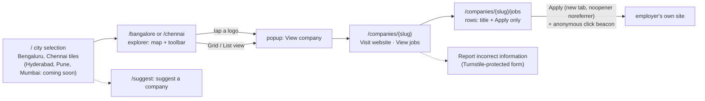
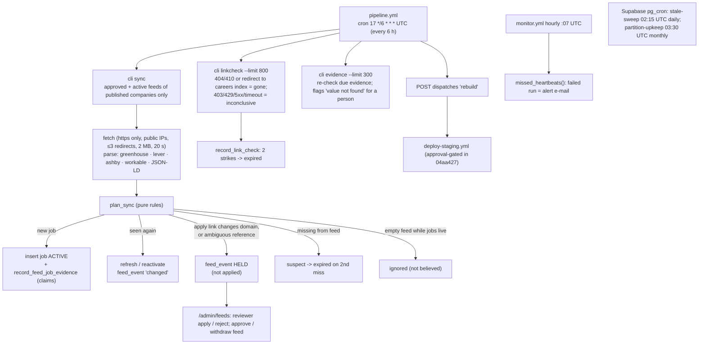
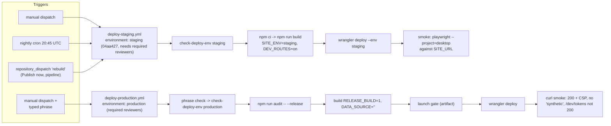

# Company Map (officemap.tech): project handover

> **Purpose.** A self-contained briefing for an assistant (ChatGPT) that has **no repository access**, so it can understand the application and guide the rest of its development.
>
> **Prepared:** 7 Oct 2026. **Reviewed code:** commit **`04aa427`** on branch `main` (local; not pushed); updated the same night for the security, test-isolation, configuration and versioning work (see the update in §0).
>
> **How it was checked:** I read the code, the 25 migrations, the workflows, the tests, `CLAUDE.md`, `plan.md`, every ADR and the whole progress log, and compared them with each other. Live facts (database counts, git, GitHub runs, hosted URLs) were checked the same day with read-only commands. Where a document disagrees with the implementation, **the implementation is described** and the disagreement is listed in [§13](#13-unresolved-inconsistencies-documentation-vs-implementation).
>
> **How to read it.** Paths are relative to the repository root. Application code lives in `code/`, so `code/lib/filters/filter.ts` is a file. Task IDs (`P9-20`), decision IDs (`D-04`) and ADR numbers (`ADR-0021`) are the project's own identifiers.

---

## 0. Executive overview

**What it is.** A **map-first company discovery portal** for Indian tech cities.
- A visitor picks a city, sees companies placed on a full-screen map at their office locations, filters and searches, and opens a company page with a "Visit website" link and a list of open jobs.
- Each job is only a title and an **Apply** link that opens the **employer's own site**.
- **No public login.** It stores **no applicant data**. Only allowlisted administrators sign in, with a password and TOTP MFA.
- Launch cities: **Bengaluru (`/bangalore`) first, then Chennai (`/chennai`)**. Domain: **officemap.tech**, owned but not configured.

**How it is built.** A Next.js 16 **static export**: every public page is prerendered, with no server rendering at request time.
- **Hosting:** a **Cloudflare assets-only Worker**.
- **Map:** MapLibre GL with a Geoapify basemap, plus a **custom WebGL2 company layer**, with **Supercluster in a Web Worker**.
- **Data:** each city's data is a **static JSON snapshot written at build time** from Supabase Postgres (PostGIS). The browser filters it with a TypeScript mirror of the SQL filter.
- **Backend:** Supabase provides the database, admin Auth with MFA, logo Storage and three Edge Functions (click counting, feedback, rebuild requests).
- **Jobs:** a Python pipeline in GitHub Actions syncs employer ATS feeds and checks links.

**Where it stands (7 Oct 2026).**

| Area | State |
| --- | --- |
| Application features (public site, map, filters, admin, evidence and publication gates, MFA, feeds, logos) | **Implemented and tested locally.** Last full local runs were green: unit 641, e2e 278 passed / 0 failed / 56 skipped, pgTAP 664, admin e2e 57, pipeline pytest 88. |
| Hosted integration | **Almost none.** No hosted Supabase project serves the site. Staging is a static synthetic-data site whose latest smoke test **failed** (a configuration cause, explained in [§8.3](#83-hosted-staging-smoke-test-failure-7-oct)). Production has **never been deployed**. |
| Real data | **Pilot only.** 46 real Bengaluru companies exist as **unreviewed local drafts**, built from 51 source-checked candidates. **0 human-reviewed, 0 published, 0 jobs, 0 logos, 0 founders.** 44 of 46 map points are only locality-accurate and are OSM-derived (licensing unresolved). Chennai has no real data. |
| Launch readiness | **Not ready.** Launch blockers: real-data volume and human review (D-04), a geocoding provider (D-07), hosted projects and their configuration, the map performance gate on real devices (D-06), an independent security approval of the audit exception, a screen-reader pass, the domain, monitoring and backups. |
| Git | `main` is **23 commits ahead** of GitHub (`origin/main` = `883de71`), plus this pass's work, uncommitted. One commit contains OSM-derived files and 20 carry Claude trailers. A rehearsed cleanup plan exists ([docs/history-cleanup-plan.md](docs/history-cleanup-plan.md)); it is **not run** and awaits the owner. |

**Update, later on 7 Oct 2026 (local, not pushed).** The four risks first listed here have been worked on. All of the
following is verified only locally; see `docs/progress.md`:
1. **Build configuration (DEP-1): fixed locally.** The deploy workflows now pass the Geoapify and Turnstile site keys, and
   a hosted build fails clearly if a required visitor feature lacks its configuration (`lib/build-features.ts`, run by both
   `check-deploy-env` and the prebuild step).
2. **The four database gaps (SEC-1 to SEC-4), the publication loophole and the listing rule: fixed locally** in migration
   `20261007150000`. Each was demonstrated first as the role that could reach it. A company now needs a *published* reviewed
   office, and a city lists a company only through a published office there with reviewed address and location.
3. **Test isolation (OPS-1/2): done locally.** Every database and admin test runs on a disposable second stack
   (`scripts/test-stack.mts`) and refuses any other database. The main local database, which holds the pilot drafts, is
   never reset.
4. **Dataset freshness (DEP-2): part 1 built locally.** Content-versioned dataset folders, immutable caching, and an
   open-tab update notice (ADR-0025). Production rebuilds: the owner chose **option C** on 8 Oct 2026 (data-only refresh of the last approved release), now built locally; see item 9.

**Follow-ups, 7–8 Oct 2026 (local, not pushed, not deployed):**
5. **Logo integrity from the bytes:** a logo becomes the company's logo only after the `activate-logo` Edge Function has
   computed the SHA-256 of the pending upload's and the public copy's bytes on the server, and both equal the upload's
   hash (`20261007160000`). No client-supplied hash or metadata counts.
6. **Dataset freshness tested:** byte-identical builds, one snapshot across explorer, pointer, manifest, company and jobs
   pages, and the open-tab notice (no notice / notice / reload uses the new snapshot / failed check harmless).
7. **Smoke tests follow deployment policy:** required features come from the deploy target (`EXPECT_DEPLOY_TARGET` and
   `REQUIRED`), not from `build-info.json`. A required feature that is off fails, demonstrated on an edited build copy.
8. **Main local database:** a backed-up, non-reset migration plan, rehearsed on a restored copy with every count
   unchanged; **not applied** ([docs/main-db-migration-plan.md](docs/main-db-migration-plan.md)). Saved previews still
   represent their original builds.
9. **ADR-0025 option C, accepted 8 Oct 2026 and built locally (never run):** `deploy-production.yml` tags each successful
   release, and `refresh-production-data.yml` rebuilds only the newest valid release tag with production data, behind every
   release check and a shrink guard, with automatic rollback (§4.5).
10. **Main local database migrated (8 Oct 2026):** at `20261007160000` after a fresh backup; all counts unchanged.
11. **Later on 8 Oct (local, not pushed, nothing deployed):**
    - **Backup drill:** database, Auth and Storage files backed up, restored into the test stack and verified part by part
      (content, grants, policies, foreign keys, file bytes, an MFA sign-in). A negative control caught every injected break.
    - **New tests found two real defects, both fixed:** unknown feeds accepted silently (#28), and an empty pilot preview
      under the listing rule.
    - **Three security fixes:** the salt is required; the client address comes only from the platform's proxy; import
      evidence is kept (#29).
    - **Dependabot:** tested, not merged.
    - **Option C:** release provenance now comes from the release record, with an approved baseline against slow shrinks
      and no rollback over newer deployments.
    - **History cleanup:** a plan, rehearsed, not run.
12. **9 Oct (local, committed, not pushed, nothing deployed):** four commits on `e0c6b95`:
    - `9de729f` DEP-3/4 and the automation gate: the staging smoke suite, validation before deploying, and nothing
      scheduled or dispatched runs until the owner sets the variables;
    - `2f99b95` FEED-CREATE: reviewers add employer feeds, always unapproved;
    - `1e78871` P2-09a/b: tests for the device tooling, with a teardown fix for the CDP stand-in;
    - `9d94050` E2E-RUN: a recorded full e2e runner that survives an interrupted session.

    **The full e2e suite has no complete result on this code.** A run on the night of 8–9 Oct took about 8 hours on a
    busy laptop and lost its summary. It left two timeouts, `gate-runner.spec.ts` and `hit-test.spec.ts`; both passed
    when rerun alone. The System log later showed the laptop in Modern Standby all night (lid closed), with each
    timeout falling on a standby transition, to the second. That is timing evidence; it was not reproduced on purpose.

    **Full e2e on `4511c15` (9 Oct, recorded):** 294 passed, 1 failed, 61 skipped. The failure: a URL that kept
    `?company=` after Escape closed the popup.
13. **Later on 9 Oct (local, committed, not pushed, nothing deployed):**
    - **The Escape/URL defect was demonstrated and fixed** (`d9ee940`; test revised in `9e34868`).
      - Cause: `useExplorerState`'s URL-tidying effect wrote its render's older state back when a close landed between a
        camera commit and that commit's effects. It now tidies the live URL.
      - Regression e2e for Escape and the close button, Back and Forward included: it fails on the old code and passes
        on the fix, idle and under load.
    - **The worker shutdown hang** was traced, by timing, to Modern Standby. The runner now keeps the machine awake and
      flags any suspension (`743fb2b`).
    - **Full suite on the final code `8093e91`: 297 passed, 0 failed, 63 skipped** (§8.1). `8093e91` is the
      application commit the complete suite validated. All 63 skips are intentional: each is a desktop-only or
      phone-only test on the other project, and no skip that depends on the environment (map key, WebGL, a logo near
      the edge) fired. Later commits change only the runner (`0420704`, checked separately) and documents.
    - An earlier attempt on `743fb2b` was ended by a Ctrl+C of unknown origin and is recorded as invalid.

Latest checks, from `code/`:
- **On the disposable test stack (7 Oct):** pgTAP 17 files, 711 passed; parity 8 passed; pipeline pytest 89 passed; admin e2e 58 passed.
- **Without a database (8 Oct, after P9-12):** lint and typecheck clean; unit 45 files, 692 passed; full e2e 293 passed, 0 failed, 59 skipped (by design; 2 workers).
- **9 Oct, before committing the batch:** lint and typecheck clean; unit 46 files, 736 passed; on the test stack, pgTAP 19 files, 781 passed and admin e2e 60 passed; smoke suite on a synthetic-staging build 6 passed, 4 skipped (by design); CDP attach 3 passed (three runs); `gate-runner.spec.ts` and `hit-test.spec.ts` 9 passed (desktop, alone). **Full e2e on `4511c15`: 294 passed, 1 failed, 61 skipped** (`.local-test-runs/20261009-050929-4511c15/`).
- **9 Oct, final code `8093e91`:** lint and typecheck clean; unit 46 files, 739 passed; **full e2e 297 passed, 0 failed, 63 skipped** (`.local-test-runs/20261009-105845-8093e91/`).
- **9 Oct, runner change `0420704` (checked at `33ed204`):** ESLint and typecheck clean. `summarize` on copies of three
  records gave unchanged counts, and the `4511c15` copy now keeps exit code 1 (it was null before). A short recorded run
  of `explorer-map.spec.ts` on desktop, started with `Start-Process`, gave 12 passed, exit 0, and an empty standby list,
  where it was previously an error. The power query over a window with a known standby pair returned 5 events.
- **P9-12 (8 Oct):** explorer JavaScript 629 → 566 KB gzipped (D-12 target 650 KB); city-selection page 134 KB (its own 150 KB budget, a proposal).

**What to do next, and who does it: [§14 Transition checklist](#14-transition-checklist-9-oct-2026).**

Sections below were written at `04aa427` and updated where these changes apply. Where a row still says "open" for these
items, the status tables in §2.2 and §10 take precedence.

---

## 1. Product and requirements

### 1.1 Purpose and users
- **Purpose:** help job seekers discover tech companies by **where their offices are**, see verified open jobs, and apply directly on the employer's site.
- **What it is not:**
  - not a job board or an applicant-tracking system;
  - no accounts, CVs, saved searches or applications are stored;
  - the only visitor data kept is an anonymous daily click counter per job or website link.
- **Users:**
  1. **public visitors:** job seekers, anonymous, on desktop and phone;
  2. **curators:** administrators in three roles, *editor* < *reviewer* < *admin*.
- **Positioning** (from the architecture plan):
  - company logos on the map, with animated clusters;
  - a tech-park view;
  - an honest accuracy label for each location;
  - only live jobs from employer sources, re-checked, with two-strike expiry;
  - zero friction (no login, no résumé);
  - small companies treated equally.
- **The Business Requirements Document is not in the repository.** Requirement IDs (MAP01…, DISC…, JOB…, ADM…, NFR…, AC01–AC10) are known only through the architecture plan. Ask the owner for the BRD before relying on any ID's exact wording.

### 1.2 User journey (implemented)

- `/bengaluru` (and `/bengaluru/*`) redirects with a 301 to `/bangalore`, through `_redirects`.
- A renamed company's old slug redirects with a 301 to its new one (generated rules).

### 1.3 Explorer features
| Feature | As implemented |
| --- | --- |
| Layout | Full-screen map with an overlay toolbar: search, filters, and a Map / Grid / List switch. On phones, filters open in a bottom sheet. |
| Search | Lower-case substring match, word by word (AND across words). Covers company name, active job titles in the city, neighbourhood and tech-park names, office addresses and published founder names. Runs in the browser over `search.json`. Suggestions come from `lib/explorer/suggestions.ts`. |
| Company type filter | Values **Startup, MNC, Product**. They are **overlapping tags** (a company can be a Startup and a Product company at once). **OR within the group, AND across groups**, with each company counted once (ADR-0004, accepted). |
| Startup stage | Pre-seed, Seed, Bootstrapped, Series A, Series B, Series C, Series C+. **Enabled only while Startup is selected.** Deselecting Startup clears the stages from the state and the URL, and a URL with stages but no Startup is normalised on load. The stage only narrows the *startup* side: "MNC + Startup + Seed" means all MNCs, or Seed startups. |
| Company status | `private / public / acquired`, a separate field and filter (ADR-0017, P9-06). Old `stage=public` URLs are rewritten to `status=`. |
| Other filters | Neighbourhood, tech park, sector (OR within each group). |
| URL state | `view, q, type, stage, status, hood, park, sector, company, map` (camera). One schema in `code/lib/filters/`; components never read `searchParams` directly. |
| One result set | Map, Grid, List and every count come from one TypeScript filter (`code/lib/filters/filter.ts`) over one dataset. A CI parity test proves it returns the same company IDs as the SQL function `company_filter` over a filter matrix (about 340 combinations per city). |
| Map | Logo markers and clusters in one WebGL2 draw call. Cluster split and merge animations (280 ms / 220 ms; reduced motion becomes a 100 ms fade). 44 px touch radius. Companies at the same address open as a circle (≤8), a spiral (9–20) or a list (>20). North-up only (rotation and tilt off, ADR-0009, still a proposal for the owner to confirm). |
| Accessibility | A keyboard-reachable mirror list for the map. Falls back to List view when WebGL2 is missing. A banner when map tiles fail. Visible focus and 44 px targets. |
| Popup | Tapping a logo sets `?company=<slug>` (Back and Forward work) and opens a popup with **View company**. On phones (<640 px) it is a bottom sheet. |
| Company page | Name, description, offices, type, stage and status, **Visit website**, **View jobs**, a "last verified" line, a report form, and Organization JSON-LD. |
| Jobs page | Each row has **only the job title and Apply**, plus a freshness line computed in the browser from the oldest `last_ok_at`. Active **and suspect** jobs are listed. |
| Not built | Hover-highlighting a list row's marker (P5-05). A cluster inheriting the selection ring of a marker it swallows (P4-03). Architecture-plan R1 extras that never became tasks (uncertain whether dropped deliberately): presets, role/role-family search, experience and work-mode filters, hiring and size filters, "Search this area", the city intro camera move, tech-park labels on the map, a "hiring" dot or 70% opacity for companies not hiring, a mini map on the company page. |

### 1.4 Design and brand rules
- **Colours (confirmed 30 Sep 2026)** are used across the whole app, public and admin:
  - **Milky `#FFFDF1`** is the background;
  - **Mantis `#59C749`** is the brand fill;
  - **Ink `#1F3A1A`** is for text;
  - **Mantis Deep `#2F7A24`** is for green that must be read.
- **Mantis on Milky is only 2.12:1.** Mantis is a fill only, never text, icons or thin lines. Text on Mantis is always Ink, never white.
- **Tokens only.** Colours are CSS variables in `code/app/globals.css`, and Tailwind's default palette is disabled. Components and shaders contain no raw hex values. The map layer reads the same CSS variables, so a palette change touches only the tokens.
- **The basemap has no green** (parks are stone `#ECE9D6`), so green always means a company.
- **Other rules:**
  - one Mantis button per view;
  - **Overpass** is the only typeface, in sentence case, never all caps;
  - **round shapes mean a company**; everything else has a 4 px radius;
  - no gradients, no other accent colours.
- **Open:** designer sign-off on the derived tokens and on the font (D-08). The basemap labels use Metropolis/Noto Sans, not Overpass (ADR-0008).

### 1.5 Rollout, domain and launch criteria
- **Sequence (ADR-0016):** both cities are built and tested from the start. **Bengaluru goes live first.** Chennai is released afterwards, after its own launch-gate run and approval. **No dates are agreed.** The architecture plan's targets (map gate 6 Nov 2026, launch 18 Jan 2027) assumed a team of about 5.5 people and are proposals only.
- **Domain:** officemap.tech is owned by the owner (D-08). DNS, canonical URLs, CSP and allowed origins for it are task **P9-15, not started**. A Worker custom domain needs the domain's DNS on Cloudflare.
- **Launch gate in code** (`code/lib/launch-gate.ts`, run by `node scripts/launch-gate.mts`; every threshold is a **proposal** under D-04):

  | Check | Bengaluru | Chennai |
  | --- | --- | --- |
  | Published companies, at least | 300 | 100 |
  | Offices at rooftop, building or campus accuracy | ≥ 90% | ≥ 90% |
  | Open jobs whose link was checked within 7 days | ≥ 90% | ≥ 90% |
  | Offices outside the city boundary | 0 | 0 |
  | Data is not synthetic; no company or job with incomplete evidence; every company has a published office | required | required |

  The architecture plan's gate is stricter:
  - 800 companies for Bengaluru and 300 for later cities;
  - ≥95% of jobs checked within **24 hours**;
  - an audit of 100 random Apply links with fewer than 2 broken;
  - performance budgets met;
  - data-owner and product-owner sign-off.

  **The owner must decide which applies (D-04).**
- **Release criteria proposed but not approved:**
  1. three consecutive green full test suites (one so far);
  2. every map point placed accurately (building-level, or reviewed by hand) before publication, and, for any point that
     comes from OSM/Nominatim, the ODbL terms met (attribution; share-alike for a derived database) or the point re-derived
     with the D-07 provider. These are two separate conditions: accuracy is a quality requirement, licensing a compliance
     one. OSM-derived data is not categorically prohibited;
  3. DEF-1 to DEF-3 closed.
- **Release checklist:** `docs/release-checklist.md` has about 19 rows, mostly owner actions, none done for a real launch.

### 1.6 Data policy (ADR-0016, ADR-0021, ADR-0022, ADR-0023)
- **Real data only, with evidence.** Every published fact must have **evidence**: a source URL and a date. Publishing requires a **human-reviewed** source, **with one exception (ADR-0022's automation exception):** jobs from an employer feed that a reviewer has **approved** are listed and updated by the pipeline with the evidence it records from that feed (claimed, not person-reviewed); a link moving to another domain, or a repeated reference, is held for a person, and the feed's approval can be withdrawn. AI may extract and organise data, but **never invents** companies, founders, locations, jobs, verification dates or logos.
- **Synthetic data** must always be labelled synthetic. **Production refuses it.**
- **Founders** are in scope as verified professional facts only, with a public correction and removal process (P9-08, not built). No founder data has been loaded.
- **Definitions (exact owner wording; ADR-0023 for Startup and MNC, ADR-0016 for Product). Use these words verbatim; do not paraphrase them:**
  - **Startup:** "A company founded to develop and scale a repeatable business model under substantial uncertainty. Apply this classification using documented evidence; funding stage alone does not determine it."
  - **MNC:** "A company with established business operations in more than one country. Overseas customers alone do not qualify it."
  - **Product:** "A company that develops and sells its own repeatable software or technology product. Companies may also offer services."
  - Company type, funding stage and ownership status stay separate, and none is inferred from another. The type tags overlap.

### 1.7 Approved, proposed, deferred and superseded

**Approved (decided by the owner):**
- the stack;
- static hosting on Cloudflare Workers static assets;
- the two cities, Bengaluru first;
- the overlapping type model;
- status kept separate from stage;
- the evidence and publication rules;
- spending: free by default, justified spend allowed on a written proposal (ADR-0018);
- MFA for administrators;
- Sentry plus Cloudflare Web Analytics, with no personal data (decided, not built);
- a 650 KB JavaScript budget (provisional);
- a Protomaps/PMTiles prototype on R2;
- off-site backups;
- officemap.tech;
- the device classes for the map gate (a mid-range Android phone, an iPhone, an ordinary laptop).

**Proposals awaiting the owner:**
- the launch-gate thresholds and coverage per city (D-04);
- the geocoding provider (D-07);
- the product name and designer sign-off (D-08);
- ADR-0009 (rotation and tilt off);
- ADR-0024 (logo storage and the three permitted-use categories);
- the ATS host allowlist (`KNOWN_ATS_HOSTS`, 15 hosts);
- the release criteria above;
- the environment separation in `docs/deploy-environments.md`.

**Deferred:**
- Phase 10:
  - a local shortlist (Dexie);
  - recently viewed;
  - compare;
  - cluster previews;
  - neighbourhood insights;
  - the PMTiles migration;
  - more cities (Hyderabad, Pune, Coimbatore, Mumbai, Gurugram+Noida);
- company claims, sponsored placement and job alerts;
- JobPosting JSON-LD (deliberately omitted);
- an admin page to manage administrators;
- an admin UI for founders and for creating employer feeds;
- the P6-04 fallback (on standby).

**Superseded:**

| Original plan | Replaced by |
| --- | --- |
| Server rendering on Workers via OpenNext; a paid Workers plan (ADR-0001 hosting, ADR-0003) | the static export (ADR-0006) |
| Cloudflare Pages | Workers static assets (ADR-0007) |
| `/go/*` redirect routes and `/api/v1` handlers | direct links plus a beacon; static datasets |
| An audit gate on production dependencies only (ADR-0015, rejected) | full audit with reviewed exceptions (ADR-0019) |
| Single `company_type` and `funding_stage` columns | tags and `startup_stage` |
| Public and Acquired as startup stages | `ownership_status` |
| "No paid plans" | "free by default" (ADR-0018) |
| Three Supabase projects | local development plus two hosted projects (staging, production) |

---

## 2. Current implementation stage

### 2.1 Validation levels
For each item, the table separates these levels:
- **Implemented:** the code exists.
- **Tested locally:** automated tests ran green on this laptop.
- **Tested hosted:** it works on staging, or on a hosted Supabase project.
- **Validated in production:** it works on the live site.

**Nothing is validated in production, because production has never been deployed.**

| Capability | Implemented | Tested locally | Tested hosted | Notes |
| --- | --- | --- | --- | --- |
| City selection page, explorer, company and jobs pages | ✅ | ✅ (e2e, axe) | ⚠️ staging, synthetic data, no basemap key | |
| WebGL layer, clustering worker, animation, hit-testing, popup, mirror list, fallbacks | ✅ | ✅ (laptop GPU and SwiftShader in CI) | ❌ never on a real phone | P2-09 gate blocked on devices (D-06) |
| Search, filters, URL state, Map/Grid/List parity | ✅ | ✅ (parity test 8/8, e2e matrix) | ⚠️ staging smoke covers the synthetic data | |
| Build-time datasets, release refusals, CSP, static-limit checks, redirects | ✅ | ✅ | ⚠️ staging builds use the seed | |
| Click beacon (`click` Edge Function) | ✅ | ✅ (unit plus a manual local run) | ❌ function not deployed | Staging builds have no Supabase URL, so no beacon is sent |
| Feedback forms (`submit-feedback`, Turnstile) | ✅ | ✅ (admin e2e with a stand-in `siteverify`) | ❌ | Real Turnstile not verified; the site key isn't passed to hosted builds |
| Admin: sign-in, TOTP MFA, roles, editing, CSV import, review queues, audit log, sources | ✅ | ✅ (admin e2e 57/57) | ❌ | Hosted MFA must be enabled by the owner |
| Evidence and publication gates (ADR-0021/0022) | ✅ | ✅ (pgTAP) | ❌ | Gaps in [§5.6](#56-known-security-gaps-found-in-the-final-sql) |
| Publish now, then rebuild dispatch | ✅ | ✅ (stand-in GitHub) | ❌ | Rebuilds go to staging only |
| Employer-feed sync, link check, evidence refresh, monitor | ✅ | ✅ (pytest 88) | ❌ (scheduled runs fail: no `PIPELINE_DATABASE_URL`) | |
| Feed governance UI (`/admin/feeds`) | ✅ | ✅ | ❌ | No UI to *create* a feed |
| Logo upload, provenance, review (P9-21) | ✅ | ✅ (pgTAP plus 4 admin e2e tests) | ❌ | Categories unconfirmed; logos are not copied into builds; no weekly logo check |
| Admin MFA (P9-13) | ✅ | ✅ | ❌ | |
| Staging deploy workflow | ✅ | n/a | ✅ deploys; ❌ latest smoke test failed | The approval-gate change is local only |
| Production deploy workflow | ✅ | n/a | ❌ never run | |
| Launch gate script, backup-restore drill | ✅ | ✅ (synthetic data and local database only) | ❌ | |
| Founder correction route and data policy page (P9-08) | ❌ | | | |
| Sentry and Web Analytics (P9-10), PMTiles (P9-11), 650 KB budget (P9-12), off-site backups (P9-14), domain (P9-15) | ❌ | | | |

### 2.2 Defects and open problems

| ID | Problem | State |
| --- | --- | --- |
| DEF-1 | "Apply" measured 17 px tall in full e2e runs | **Fixed in the test harness.** The cause was shown to be the tests reading layout while the stylesheet was pending. The page is never painted unstyled. ([§8.4](#84-defects-def-1-def-2-def-3)) |
| DEF-2 | Map-load timeouts under parallel e2e load | **Mitigated.** At most one map-heavy test runs at a time. Not proven gone. |
| DEF-3 | A tapped cluster was still drawn after the camera flight | **Test bug fixed** with `settleOnView()`; passes in the full suite. `plan.md` still says "Open". |
| SEC-1 | Updates to tag, sector and job-city rows bypassed the reviewed-evidence change gate | **Fixed locally** (`20261007150000`; [§5.6](#56-known-security-gaps-found-in-the-final-sql)) |
| SEC-2 | A logo could sit in the public bucket without being approved | **Fixed locally** (approve, copy, then activation by a server-side SHA-256 of the bytes, `20261007160000`) |
| SEC-3 | Pipeline-written jobs were not evidence- or feed-gated in SQL | **Fixed locally** (`pipeline_job_gate`; feed automation preserved) |
| SEC-4 | Callers with no signed-in user (service role) could insert pre-reviewed evidence, publish, approve feeds, set logos | **Fixed locally** (only the database owner is trusted) |
| DEP-1 | Deploy workflows didn't pass the Geoapify or Turnstile site keys | **Fixed locally** (workflows map them; deploy and prebuild checks fail without them) |
| DEP-2 | Rebuilds could change data under the same URL; no cache rule for `/data/*` | **Fixed locally** (content-hashed folders, ADR-0025 part 1; determinism, snapshot consistency and the open-tab notice are tested). The production rebuild policy awaits the owner; option C is now a concrete proposal |
| DEP-3 | The staging smoke test runs the whole synthetic-data desktop suite | **Fixed locally (9 Oct 2026)**: `tests/smoke` (playwright.smoke.config.ts) takes every expectation from the site's own manifest, data files and build-info, and from the deployment policy (`EXPECT_DEPLOY_TARGET`). It passed on a synthetic-staging build and on a real-data staging build (built from the test stack's API), and refused a synthetic build checked as real-data staging, and a wrong commit |
| DEP-4 | Staging deploys before its smoke test, so a failing build stays live | **Fixed locally (9 Oct 2026)**: `deploy-staging.yml` validates the exact build served locally (`scripts/smoke-local.mts`) before deploying, smoke-tests the live site after, and rolls back to the previous version (only if the version serving is the one it deployed). Never run on GitHub |
| OPS-1 | Admin e2e global setup deletes all `admin_user` rows and adds test companies | **Fixed locally**: it now runs only on the disposable test stack and refuses any other database |
| UX-1 | "Open jobs" counts differ: the explorer counts active jobs only; the company page and jobs page include *suspect* jobs | **Open** (owner decision) |
| FEED-1 | `approve_job_feed` / `withdraw_job_feed` accepted an unknown feed silently (a `PERFORM` reset `FOUND`) | **Fixed locally** (`20261008090000`; found by pgTAP `17_feed_review`) |
| PREVIEW-1 | `preview-db.mts` produced a preview with no companies under the 7 Oct listing rule | **Fixed** (the copy's evidence is marked reviewed by a named stand-in, in the copy only) |

### 2.3 The running local previews (as of 7 Oct 2026)

| URL | Contents | Built from | Limitations |
| --- | --- | --- | --- |
| **http://127.0.0.1:8788/** | **Synthetic sample data**: 48 Bengaluru and 24 Chennai companies, every page labelled "synthetic. None of them is real." `/dev` pages included. | `code/out/`, built 7 Oct 09:27 IST by the e2e run. Application code identical to `18f58b2`/`04aa427` (later commits changed only docs, workflows and a script). `DEV_ROUTES=on`, `DATA_SOURCE=seed`, Supabase URL = local stack, Turnstile always-pass test key, Geoapify key from `.env.local`. | Admin works against the local Supabase stack (password plus TOTP). The beacon and feedback calls fail quietly, because the local Edge Functions aren't being served. |
| **http://127.0.0.1:8789/** | **Real-company pilot, unreviewed**: 46 Bengaluru companies, Chennai empty. A banner on every page says the records are unreviewed candidates. noindex. | A scratch copy of `code/` in the session's temp folder, built with `PILOT_PREVIEW=1 SITE_ENV=pilot-preview` from the scratch database `pilot_preview`. In that copy only, synthetic and test companies are removed and the pilot drafts are shown as if published; no reviews or approvals are recorded. | **Not for any deployment** (refused by `RELEASE_BUILD`). Its CSP has no Supabase origin, so admin cannot sign in here and logos fall back to letters. 44 of 46 markers are at **locality centroids** (OSM/Nominatim, low accuracy, licensing unresolved). No jobs. Whether the Geoapify key's referrer restriction allows port 8789 is **unverified**. |

`/dev` pages on the 8788 preview:
- `/dev/tokens/`: palette and contrast table;
- `/dev/basemap/`;
- `/dev/map-layer/`: synthetic S/M/L datasets, `?runner=1` for the in-page device-gate runner;
- `/dev/map-lifecycle/`;
- `/dev/cluster-worker/`;
- `/dev/explorer-list/`.

---

## 3. Repository structure

### 3.1 Tree
```
/ (repository root)
├─ CLAUDE.md                    Rules for the AI coding assistant (scope, stack, design, security, commands, hard rules)
├─ plan.md                      Task plan (phases P1–P10, task IDs, statuses) and the open-decision register D-01…D-12
├─ Company Map — Architecture & Implementation Plan.md   Original architecture plan (30 Sep 2026); CLAUDE.md overrides it where they conflict
├─ PROJECT_HANDOVER.md          This file
├─ docs/
│  ├─ progress.md               Dated work log (newest first; its "Current state" header is stale, see §13)
│  ├─ decisions/                ADR-0001…0024 + README (index and status) + template
│  ├─ map-spec.md, design-system.md, data-model.md, filters.md, data-pipeline.md, architecture.md, security.md,
│  │  curation-guide.md, testing.md, release-checklist.md, backup-restore.md, deploy-environments.md,
│  │  real-device-test-procedure.md, setup-new-machine.md
│  └─ claude-memory/            Copy of the assistant's working-memory notes (out of date; see §13)
├─ .github/workflows/           ci.yml, deploy-staging.yml, deploy-production.yml, pipeline.yml, monitor.yml (+ dependabot.yml)
├─ .local-backups/              git-ignored local database dumps
└─ code/                        The application (all commands run from here)
   ├─ app/                      Next.js routes, all prerendered
   │  ├─ layout.tsx             root layout: font, metadata, noindex unless production, pilot banner
   │  ├─ (public)/              page.tsx (city selection), [city]/page.tsx (explorer), companies/[slug]/page.tsx,
   │  │                         companies/[slug]/jobs/page.tsx, suggest/page.tsx, layout.tsx (sample-data notice)
   │  ├─ admin/                 client-rendered admin: dashboard + Publish now, companies, offices, jobs (list/edit),
   │  │                         import (CSV), review, feeds, audit, sources
   │  ├─ dev/                   *.page.dev.tsx, built only with DEV_ROUTES=on or under `next dev`
   │  ├─ robots.ts, sitemap.ts, not-found.tsx, globals.css (design tokens)
   ├─ components/               explorer/ (shell, toolbar, filters, popup, Grid/List, a11y list), company/ (outbound links,
   │                            avatar, freshness), feedback/ (forms, Turnstile), admin/ (root/auth/MFA, evidence panel,
   │                            logo panel), city/, ui/ (shadcn)
   ├─ lib/                      filters/ (schema, URL state, TS filter, dataset schema), api/ (data source, snapshot reader),
   │                            data/ (build-time readers, browser fetch, logo URLs), explorer/ (URL hook, suggestions),
   │                            admin/ (CSV, import, forms, publish), supabase/browser.ts, csp.ts, links.ts, redirects.ts,
   │                            launch-gate.ts, audit-gate.ts, site.ts, beacon.ts, feedback.ts, design/
   ├─ map/                      no React: explorer-map.ts (controller), basemap.ts, layer/ (WebGL), worker/ (Supercluster +
   │                            Comlink), atlas/ (logo atlas), animation/, hit-test/, popup-placement.ts, a11y-mirror.ts,
   │                            fallback.ts, theme.ts, fixtures/ (synthetic S/M/L)
   ├─ supabase/                 config.toml, migrations/ (25 files), functions/ (click, submit-feedback, request-rebuild,
   │                            _shared/*-handler.ts), seed/ (synthetic SQL + snapshots), tests/database/ (16 pgTAP files)
   ├─ scripts/                  *.mts build/ops tools; pipeline/ (Python jobs + tests); pilot/ (research checking, import,
   │                            preview DB)
   ├─ data/pilot/bangalore/     pilot research JSON, verification, candidates (OSM-derived outputs git-ignored)
   ├─ security/                 audit-exceptions.json, authorized-approvers.json
   ├─ config/redirects.static   static redirect rules
   ├─ public/_headers           response headers (3 rules); public/data, public/maplibre, _redirects are generated
   ├─ tests/                    unit/ (Vitest, 40 files), e2e/ (Playwright), a11y/, admin/ (real local stack), gate/,
   │                            parity/
   ├─ next.config.ts, wrangler.jsonc, package.json, playwright*.config.ts, vitest*.config.*
   └─ AGENTS.md / CLAUDE.md     Next.js 16 notice: read node_modules/next/dist/docs before using an API (Next 16 differs)
```

### 3.2 Entry points and where to change behaviour

| Behaviour | Where |
| --- | --- |
| Public pages | `code/app/(public)/page.tsx`, `[city]/page.tsx`, `companies/[slug]/page.tsx`, `companies/[slug]/jobs/page.tsx`, `suggest/page.tsx`. Data assembly: `code/lib/data/city-data.ts`, `company-data.ts`. |
| Launch cities | `CITY_SLUGS` in `code/lib/filters/schema.ts`; `COMING_SOON` in `app/(public)/page.tsx`; `EXPLORER_PATH` in `lib/explorer/last-explorer.ts`; the `city` table (boundary, centre, `status` draft/beta/live). |
| Filter semantics | `code/lib/filters/filter.ts` **and** the SQL `company_filter_parsed` (migrations `20261003110000`, last redefined in `20261006090000`). Both must change together, and the parity test (`tests/parity/filter-parity.test.ts`) must stay green. |
| Filter values, stage gating | `code/lib/filters/schema.ts` (`normalizeFilters`, `applyFilterChange`). |
| URL format | `code/lib/filters/url.ts`; hook `code/lib/explorer/use-explorer-state.ts`. |
| Search | `prepareIndex` and `searchTokens` in `lib/filters/filter.ts`; suggestions `lib/explorer/suggestions.ts`. |
| Clustering | `CLUSTER_OPTIONS` in `code/map/worker/protocol.ts` (radius 60, maxZoom 17, minPoints 2, extent 512). Engine: `map/worker/cluster-engine.ts`. |
| Map controller, zoom limits | `code/map/explorer-map.ts` (MIN_ZOOM 8, MAX_ZOOM 19, SELECT_ZOOM 17). |
| Marker drawing | `code/map/layer/company-layer.ts`, `map/layer/shaders/marker.ts`, `map/theme.ts`. |
| Logo atlas | `code/map/atlas/` (budget 64 MB on touch / 128 MB otherwise, 2048 px pages, max 8 pages). |
| Basemap | `code/map/basemap.ts` (Geoapify `positron`, re-coloured from tokens). MapLibre is loaded at run time from `public/maplibre/<version>/` by `loadMapLibre()`, never bundled. |
| Popup | `components/explorer/map-popup.tsx`. |
| Outbound URL rules | `code/lib/links.ts` (https, employer domain, `KNOWN_ATS_HOSTS`). Enforced at build: a failing URL fails the build. |
| Beacon | `lib/beacon.ts`, `components/company/outbound-link.tsx`, `supabase/functions/click/`. |
| Feedback | `components/feedback/*`, `lib/feedback.ts`, `supabase/functions/submit-feedback/`. |
| Admin auth, MFA, roles | `components/admin/admin-root.tsx`; SQL `is_admin()` (final version in `20261007140000_admin_session_checks.sql`). |
| CSV import | `app/admin/import/page.tsx`, `lib/admin/csv.ts`, `import-rows.ts`, `import-evidence.ts`; SQL `import_commit`. CSV only; there's no JSON import UI. |
| Evidence review, publication | `components/admin/evidence-panel.tsx`, `app/admin/review/page.tsx`; SQL in `20261006120000`, `20261006150000`, `20261007090000`. |
| Feeds | Python `code/scripts/pipeline/` (`feeds.py` providers, `plan.py` rules, `repo.py` DB writes, `sync.py`, `linkcheck.py`, `evidence.py`, `fetch.py` network rules, `cli.py`). UI `app/admin/feeds/page.tsx`. SQL `20261006170000`, `20261006190000`. |
| Logos | `components/admin/logo-panel.tsx`, `lib/data/logo.ts`; SQL `20261007110000`, `…120000`, `…130000`. |
| Publish now | `app/admin/page.tsx`, `lib/admin/publish.ts`, `supabase/functions/request-rebuild/`, SQL `publish_now`. |
| Data source and release refusals | `code/lib/api/data-source.ts`, `code/scripts/build-datasets.mts`. |
| CSP | `code/lib/csp.ts`, `scripts/inject-csp.mts` (a per-page meta tag with script hashes). Other headers: `public/_headers`. |
| Indexing | `code/lib/site.ts` (indexable only when `SITE_ENV=production`), `app/robots.ts`, `app/sitemap.ts`. |
| Static-hosting limits, secret scan | `code/scripts/check-static-limits.mts`. |
| Deploy environment rules | `code/scripts/check-deploy-env.mts` (new in `04aa427`). |
| Launch thresholds | `code/lib/launch-gate.ts`. |
| JavaScript budget | `code/tests/e2e/budgets.spec.ts`. |

---

## 4. Architecture and application flows

### 4.1 Stack and providers (actual versions)

| Layer | Choice |
| --- | --- |
| Front end | Next.js **16.3.7** App Router with `output: "export"`; React **19.2.8**; TypeScript (strict); Tailwind CSS 4; shadcn/ui on Radix; TanStack Query 5; TanStack Virtual 3; Zod **4.6.5**. Node ≥ 24. |
| Map | MapLibre GL **6.11.2** (not bundled); a custom WebGL2 layer; Supercluster **9.1.0** in a Web Worker via Comlink **4.4.2**; kdbush for hit-testing. |
| Basemap | Geoapify vector tiles, `positron` style re-coloured. The key is public, and restricting it by referrer is still pending. Free tier capacity is about 240 sessions a day (ADR-0008, D-11). Protomaps PMTiles on R2 is the planned replacement (P9-11). |
| Hosting | Cloudflare **Workers static assets** (an assets-only Worker; no script, no request-time compute). Workers `company-map` (production) and `company-map-staging`. Deployed with `wrangler` 4.144. |
| Backend | Supabase: Postgres + PostGIS + pg_trgm + full-text search; Row-Level Security; SQL functions (RPC); Auth (admins only, TOTP); Storage (logos); Edge Functions (Deno 2); pg_cron. Supabase CLI 2.118. |
| Jobs and data pipeline | Python 3.13 in GitHub Actions (psycopg 3). |
| Bot protection | Cloudflare Turnstile, verified inside the `submit-feedback` Edge Function. |
| Tests | Vitest 5, Playwright 1.63 with axe-core, pgTAP, pytest. |
| CI and security | GitHub Actions; gitleaks 8.30.1; Dependabot weekly; `npm run audit` gate with a reviewed exception register. |
| Not added (forbidden without an ADR) | FastAPI, Celery, Redis, AWS, Kubernetes, a separate search engine, MapLibre's built-in clustering. |
| Decided but not built | Sentry and Cloudflare Web Analytics (P9-10), Dexie (Phase 10), PMTiles (P9-11). |

**Constraints of static hosting:**
- No request-reading Route Handlers, Server Actions, middleware/proxy, cookies, ISR, `next.config` redirects, rewrites or headers, or default image optimisation.
- Redirects go in `_redirects`; headers in `public/_headers`.
- The Next.js app holds **no secrets**.
- Workers static assets Free limits:
  - 20,000 files and 25 MiB per file;
  - 2,000 static plus 100 dynamic redirects;
  - 100 header rules.
- Each prerendered page costs **5 files**, so a company (company page plus jobs page) costs 10. The build warns above 15,000 files (that is the trigger for P6-04, moving jobs onto the company page) and fails above 18,000. The current synthetic build has 822 files.

### 4.2 Public browsing
```mermaid
sequenceDiagram
  participant B as Browser
  participant CF as Cloudflare assets Worker
  participant W as Web Worker (Supercluster)
  participant G as Geoapify
  participant S as Supabase Storage (public logos)
  participant EF as Edge Function "click"
  B->>CF: GET /bangalore (prerendered HTML; data file paths + data_version baked in)
  B->>CF: GET /data/bangalore/{v}/companies.json + offices.json
  B->>B: prepareIndex + filterResult (one TS filter -> map, grid, list, counts)
  B->>CF: GET /maplibre/{ver}/maplibre-gl.mjs (run-time load)
  B->>G: style + vector tiles
  B->>W: load(points) · getClusters(bbox, zoom, generation)
  W-->>B: clusters (typed arrays; stale generations dropped)
  B->>S: logo images, for drawn markers only (letter fallback until loaded)
  B->>B: tap logo -> ?company=slug -> popup -> View company
  B->>CF: GET /companies/{slug}/ then /companies/{slug}/jobs/
  B->>EF: navigator.sendBeacon {kind:"apply", id} (no personal data)
  B-->>B: Apply opens the employer URL in a new tab
```
- `search.json` loads lazily, the first time search is used.
- The browser does **not** fetch `manifest.json`; the build bakes the paths into the page.
- `details.json` is used only at build time for the company pages, though it is also published.
- With no Supabase URL in the build, there is no beacon and logos fall back to letters.

### 4.3 Admin publication
```mermaid
sequenceDiagram
  participant A as Admin browser (/admin, client-rendered)
  participant AU as Supabase Auth
  participant DB as Postgres (RLS + RPC)
  participant RR as Edge Function request-rebuild
  participant GH as GitHub API
  participant WF as deploy-staging.yml
  A->>AU: email + password (aal1)
  A->>AU: TOTP enrol (first time) or verify -> aal2
  A->>DB: editor: admin_save_company / office / job, CSV import_commit (drafts + evidence claims)
  A->>DB: reviewer: review_evidence, publish (status change), review_logo
  Note over DB: triggers enforce reviewer role, reviewed evidence,<br/>change gate, logo gate; audit_log records everything
  A->>RR: Publish now (Bearer JWT)
  RR->>DB: publish_now() as the caller (reviewer + aal2): bump every city's data_version; 10-min debounce
  RR->>GH: POST /repos/{repo}/dispatches {event_type: "rebuild"}
  GH->>WF: repository_dispatch
  WF->>WF: (04aa427) wait for staging-environment approval -> check-deploy-env -> build -> wrangler deploy --env staging -> smoke
```
- **Production has no rebuild trigger.** Publish now never updates production. Production changes only when someone runs `deploy-production.yml` by hand.

### 4.4 Employer-feed updates

**Gaps:**
- Feeds can only be created with SQL; there is no UI for it.
- Retries with backoff, robots.txt handling and a 1-request-per-second-per-host limit are documented but **not implemented**.
- The pipeline's rebuild does not bump `data_version`.

### 4.5 Static snapshots, versions, caching and freshness

**Build pipeline** (`npm run build` in `code/`):
1. `prebuild`:
   - `scripts/copy-maplibre.mts`;
   - `scripts/build-datasets.mts --require`, which picks the data source, calls `city_build_snapshot(city)` per city, validates with Zod, refuses empty cities and any mix of real and synthetic companies, and applies the release rules. It writes `public/data/<city>/<data_version>/{companies,offices,search,details}.json` and `manifest.json`, deletes old versions, and writes `_redirects` (static plus slug redirects).
2. `next build` (static export; `.dev.tsx` pages only when `DEV_ROUTES=on`; the build fails on any invalid outbound URL).
3. `postbuild`:
   - `fix-segment-files.mts` (Windows prefetch file-name repair);
   - `inject-csp.mts` (a meta CSP per page);
   - `check-static-limits.mts` (file, size, redirect and header limits, and a secret scan).

**Data source order** (`code/lib/api/data-source.ts`; the first match wins):
1. `rest`: `NEXT_PUBLIC_SUPABASE_URL` and anon key set. Calls the RPC over HTTP as `anon`.
2. `local`: `LOCAL_DATABASE_URL`. Uses `pg`, `set local role anon`, and rolls back.
3. `seed`: `DATA_SOURCE=seed` (the committed synthetic snapshots in `supabase/seed/snapshots/`).
4. No source with `--require`: the build fails (ADR-0010).

**Release and pilot safeguards:**
- `RELEASE_BUILD=1` (production only) refuses synthetic data, `PILOT_PREVIEW`, and any company or job whose `evidence_complete` is false.
- `PILOT_PREVIEW=1` accepts only a local database on 127.0.0.1 or localhost and shows a banner.
- noindex comes from `SITE_ENV`, which must not be `production`.

**Dataset versions (DEP-2, [ADR-0025](docs/decisions/0025-dataset-versions-and-rebuild-policy.md) part 1, built locally 7 Oct 2026):**
- `data_version` is still an integer per city, bumped only by `publish_now`.
- Each city's files go in a folder named `<data_version>-<content hash>` (`public/data/<city>/<folder>/{companies,offices,search,details}.json`), so **changed content always gets new URLs**, whatever triggered the rebuild. A build deletes the city's older folders.
- `/data/<city>/current.json` names the current folder.
- `public/_headers`: version folders are `immutable` for a year; `current.json` is `no-cache`.
- **Open tabs:** when an explorer tab becomes visible again, at least five minutes after its last check, it fetches `current.json` (`no-store`). If the folder changed, it offers a reload; if the check fails, it says nothing and browsing continues (`components/explorer/explorer.tsx`).
- **Tested (7 Oct 2026):**
  - two separate builds of the same data are byte-identical, and each folder is named by its files' hash (`tests/unit/dataset-determinism.test.ts`);
  - each explorer, pointer and manifest names the same snapshot, and company and jobs pages show what it holds (`tests/e2e/snapshot-consistency.spec.ts`); Map, Grid and List counts are checked by the existing explorer and phone specs;
  - the open-tab notice: unchanged content gives no notice, changed content gives one and the reload uses the new snapshot, and a failed check leaves browsing working (`tests/e2e/open-tab-update.spec.ts`).
- **How production rebuilds** (ADR-0025 part 2): **option C, accepted 8 Oct 2026, built locally and never run.**
  - `deploy-production.yml` creates an annotated `release/<yyyymmdd-hhmm>-<run>` tag after a successful release, and keeps the release files for 90 days.
  - `refresh-production-data.yml` (Publish now on the production project, every 6 h at :47, or by hand) rebuilds the newest valid release tag with production data. A tag is refused unless it is annotated, made by `github-actions[bot]`, and on `main`. The run checks config, audit, `RELEASE_BUILD`, the launch gate, and the shrink guard (a drop over 20% in companies or jobs waits for a person).
  - It deploys only when a dataset changed, rolls back to the previous Worker version on failure, and keeps the files for 30 days. It shares the `deploy-production` concurrency group.
  - Code: `lib/release.ts`, `scripts/{release-tag,refresh-guard,worker-version}.mts`, `scripts/smoke-production.sh`. Owner setup: [docs/deploy-environments.md](docs/deploy-environments.md).

**Caching:** `/_next/static/*`, `/maplibre/*` and dataset version folders are `immutable` for one year; `current.json` is `no-cache`. Pages use the default caching.

**Freshness shown to visitors:**
- **Jobs page:** "Checked today / N days ago", from the oldest `last_ok_at` among the listed jobs.
- **Company page:** "last verified", from `last_verified_at`, which the publication gate sets from the evidence dates.
- **The launch gate uses `last_checked_at` instead** (two definitions; see [§13](#13-unresolved-inconsistencies-documentation-vs-implementation)).

**Rebuild triggers:**

| Trigger | Target |
| --- | --- |
| Nightly cron at 20:45 UTC (02:15 IST) | staging |
| Publish now (`repository_dispatch: rebuild`) | staging |
| Pipeline run (every 6 h, dispatches `rebuild`) | staging |
| Manual run of either deploy workflow | staging or production |
| Publish now on the **production** project (`refresh-production-data` event), every 6 h at :47, or by hand | production, data only: the last approved release tag rebuilt (ADR-0025 option C; never run) |

**Map worker:**
- Points are sent as transferable typed arrays.
- Each request carries a generation number, and stale responses are dropped.
- Keys are namespaced by `data_version` and the filter hash.
- `dispose()` terminates the worker.

**Logo atlas:**
- Logos load at run time from `https://<project>.supabase.co/storage/v1/object/public/company-logos/<companyId>/<sha256>.<ext>`.
- Raster formats only, at most 1 MB, decoded into 2048² atlas pages with LRU eviction and a letter fallback.
- **Logos are not copied into the build**, despite what `docs/architecture.md` says.
- The `allowedHosts` check exists in the loader, but the explorer doesn't pass it, so the CSP is the effective guard.

**External dependencies at run time:**
- in the browser: Geoapify, Supabase Storage and Functions, and Cloudflare Turnstile (loaded only when a form renders);
- server side: Turnstile `siteverify`, GitHub dispatches, employer ATS APIs and pages;
- pilot only: Nominatim (OSM).

### 4.6 Build and deployment

- On GitHub today (`origin/main`), staging has **no environment gate**. It falls back to synthetic data when `vars.SUPABASE_URL` is empty, and reads repository-level variables.
- The environment gate and `check-deploy-env` exist only in local commit `04aa427`.

---

## 5. Database and security

### 5.1 Migrations (`code/supabase/migrations/`, in order)
1. `20260930181053_extensions`: PostGIS, pg_trgm.
2. `20261003090000_core`: types, geography (city, neighbourhood, tech_park), source, company, type tags, sectors, founders, office, job, job_city; the city-boundary trigger; the "stage needs startup" trigger; the search document.
3. `20261003100000_rls`: `admin_user`, `is_admin()` v1, revokes, public-read and admin policies, `require_reviewer_to_publish`.
4. `20261003110000_filter_functions`: `parse_filters`, `company_filter[_parsed]`, `city_points`, `search_companies`, `company_facets`.
5. `20261003120000_city_snapshot`: `city_build_snapshot` v1.
6. `20261005090000_snapshot_boundary`: `company.is_synthetic`; boundary in the snapshot.
7. `20261005100000_clicks_and_slug_redirects`: `slug_redirect`, `link_click_daily`, `record_click`.
8. `20261005110000_admin`: `audit_log` (append-only) and triggers, `site_state`, `publish_now`, `import_batch`, `import_commit` v1, `review_offices` view.
9. `20261005120000_job_defaults`: normalised job title and the dedup hash.
10. `20261005130000_admin_views`: the `admin_offices` view.
11. `20261005140000_admin_save`: `admin_save_company`, `admin_save_job`, `admin_delete_company`.
12. `20261005150000_pipeline`: the `pipeline` role, `job_feed`, partitioned `verification_check`, `record_link_check`, `heartbeat`, stale sweep, pg_cron jobs.
13. `20261005160000_feedback`: `submission`, `feedback_rate`, `submit_feedback`.
14. `20261006090000_ownership_status`: the status enum and column; stages without public/acquired; a `statuses` filter group.
15. `20261006120000_field_evidence`: `field_evidence`, review functions, `publication_problems`, `publication_approval`, the publication gate.
16. `20261006130000_import_evidence`: `import_commit` requires evidence per field (final version).
17. `20261006150000_evidence_jobs_refresh`: job evidence, proposed values, `self_reviewed`, the refresh policy and checks, the job publication gate, the change gate for public facts, `*_evidence_complete`, the final `city_build_snapshot`.
18. `20261006170000_feed_governance`: feed approval, `feed_event`, `record_feed_job_evidence`.
19. `20261006190000_feed_review_actions`: `withdraw_job_feed`, `resolve_feed_event`.
20. `20261007090000_reviewed_optional_facts`: the final `publication_problems`; optional facts need **reviewed** evidence.
21. `20261007100000_admin_mfa`: `is_admin()` requires `aal2` (superseded by #25).
22. `20261007110000_logo_assets`: the `company-logos` bucket, `logo_asset`, `review_logo`, `logo_key_gate`.
23. `20261007120000_logo_permission_evidence`: the terms quote and the storage, display and atlas permissions.
24. `20261007130000_logo_pending_bucket`: the private `company-logos-pending` bucket; reworked storage policies.
25. `20261007140000_admin_session_checks`: the final `is_admin()` (live session row, verified factor); pipeline functions revoked from `anon` and `authenticated`.
26. `20261007150000_security_gaps`: SEC-1 to SEC-4, the publication loophole (a company needs a *published* reviewed office), `listed_office()` for listings, and logo approve → copy → activate.
27. `20261007160000_logo_sha256`: logo activation by server-side SHA-256 (`request_logo_activation`, the `activate-logo` Edge Function, `complete_logo_activation` for `service_role` only); drops `activate_logo(bigint)`.

28. `20261008090000_feed_unknown_feed`: `approve_job_feed` and `withdraw_job_feed` raise "no feed" again for an unknown feed. A `PERFORM` had reset `FOUND`, so the error never fired. Found by the new pgTAP `17_feed_review`.
29. `20261008100000_import_keeps_company_evidence`: `import_commit` keeps the company evidence on a row that adds an office to an existing company. It is stored as unreviewed claims for the row's values; a different value is only a proposal. The row's result says what was kept. Evidence for a field the row leaves empty is refused.

30. `20261008110000_create_job_feed`: `create_job_feed()` for aal2 reviewers and admins (company and source checked, board name or careers page on the company's domain, no duplicates); a new feed is always unapproved; `job_feed.created_by`, `created_at`.

Migrations 28 to 30 are on the test stack only; the main local database is at #27 (rehearsed on a copy, 9 Oct: §14.1). Bring it up to date with the same procedure as [docs/main-db-migration-plan.md](docs/main-db-migration-plan.md) when the owner says so.

Migrations 26 and 27 were applied to the main local database on 8 Oct 2026 with `supabase migration up`, after a fresh backup and a rehearsal on a restored copy; all counts were unchanged ([docs/main-db-migration-plan.md](docs/main-db-migration-plan.md)).

**Rule:** schema changes go only in **new** migration files. Never edit an applied migration.

### 5.2 Tables (public schema)

**Geography**

| Table | Purpose | Key fields |
| --- | --- | --- |
| `city` | A launch city | `slug`, `name`, `aliases[]`, `status` (draft/beta/live; only beta or live are public), `centre`, `default_zoom`, `boundary` (MultiPolygon), `data_version` |
| `neighbourhood`, `tech_park` | Places inside a city | `city_id`, `slug` (unique per city), `name`, geometry |

**Companies**

| Table | Purpose | Key fields |
| --- | --- | --- |
| `source` | Where data comes from | `kind` (ats_feed, jsonld, csv_import, suggestion, manual), **`permission_note` (required)**, `base_url` |
| `company` | A company | `slug` (unique), `domain` (unique, lower-case; **the deduplication key**), `name`, `logo_key`, `description`, `size_band`, `startup_stage`, `ownership_status`, `website_url` (https, required), `careers_url`, `status` (draft/published/unpublished/merged), `merged_into`, `last_verified_at`, `search_doc`, **`is_synthetic`** |
| `company_type_tag` | Overlapping type tags | `(company_id, type ∈ startup/mnc/product)` |
| `sector`, `company_sector` | Sectors | many-to-many |
| `company_founder` | A founder | `full_name`, https `source_url`, `status` (draft/published). Published founders are searchable. **No admin UI.** |

**Offices and jobs**

| Table | Purpose | Key fields |
| --- | --- | --- |
| `office` | An office | `company_id`, `city_id`, `neighbourhood_id`, `tech_park_id`, `address`, `geom` (point), **`accuracy`** (rooftop/building/campus/street/locality), `verification` (unverified/auto/reviewed), `outside_reviewed`, `status`, `last_verified_at`. A published office must lie inside the city boundary unless `outside_reviewed` is set. |
| `job` | A job | `company_id`, `source_id`, `external_ref`, `title`, `title_norm`, `apply_url` (https), `dedup_hash` (unique per company), `work_mode`, experience range, `posted_at`, `status` (active/suspect/expired/withdrawn/draft), `last_checked_at`, `last_ok_at`, `consecutive_failures`, `closed_at` |
| `job_city` | Which cities a job is in | `(job_id, city_id)`, optional `office_id` |

**Administration and site state**

| Table | Purpose | Key fields |
| --- | --- | --- |
| `admin_user` | The admin allowlist | `user_id` → `auth.users`, `role` (editor/reviewer/admin) |
| `audit_log` | Append-only change history | actor, role, table, row, action (insert/update/delete/publish_now/import), before and after JSON |
| `slug_redirect` | Old slug → company | |
| `link_click_daily` | Anonymous click counts | `(day, kind ∈ apply/website, target_id, count)`; no personal data |
| `site_state` | Rebuild debounce timestamp | |
| `import_batch` | Import history | |

**Pipeline**

| Table | Purpose | Key fields |
| --- | --- | --- |
| `job_feed` | An employer ATS feed | `provider` (greenhouse/lever/ashby/workable/jsonld), `identifier`, `active`, `approved_by`, `approved_at`, `approval_note`, `withdrawn_note` |
| `feed_event` | What a feed sync did or held back | kind (inserted/changed/held_domain_change/held_ambiguous/suspect_missing/closed_missing), old and new value, decision (applied/rejected) plus note |
| `verification_check` (monthly partitions) | Link-check results | |
| `heartbeat` | Last good run per scheduled job | `name`, `last_ok_at`, `expected_every`, `grace` |

**Feedback**

| Table | Purpose | Key fields |
| --- | --- | --- |
| `submission` | Public reports and suggestions | kind, target, message (≤1000 characters), https `source_url`, status (new/resolved/rejected) |
| `feedback_rate` | Rate-limit buckets | salted hash of client and hour, count |

**Evidence**

| Table | Purpose | Key fields |
| --- | --- | --- |
| `field_evidence` | One row per piece of evidence for one field | exactly one of `company_id`/`office_id`/`founder_id`/`job_id`; `field`; `value`; https `source_url`; `verified_at`; `note`; `recorded_by`/`recorded_at`; `reviewed_by`/`reviewed_at`; generated `self_reviewed`. Fields: company name, website, description, types, sectors, startup_stage, ownership_status; office address, location; founder full_name; job title, employer, location, apply_url |
| `publication_approval` | Who published or unpublished what | company, office, founder or job; action; approver; time |
| `evidence_refresh_policy` | How often evidence is re-checked | jobs daily; company name, website and description weekly; everything else every 30 days |
| `evidence_check` | Results of those re-checks | |

**Logos**

| Table | Purpose | Key fields |
| --- | --- | --- |
| `logo_asset` | Logo provenance and review | `storage_key` (`<companyId>/<sha256>.<ext>`), content type (raster only), bytes ≤ 1 MiB, `source_url`, `permitted_use` (company_brand_assets / written_permission / licensed_provider; **proposals**), `permission_url`, `permission_note`, `terms_quote` (≥20 characters), `allows_storage`/`allows_display`/`allows_atlas` (all must be true), `obtained_on`, uploader, decision, reviewer, `self_reviewed` |

**Views:** `review_offices` and `admin_offices`, both security-invoker and not available to `anon`.

**Storage buckets:**

| Bucket | Public | Limit | Types | Who writes |
| --- | --- | --- | --- | --- |
| `company-logos-pending` | **private** | 1 MiB | png, jpeg, webp, gif, avif | editors upload; admins delete |
| `company-logos` | public read | 1 MiB | same | a reviewer copies in a file whose `logo_asset` is undecided; admins delete. No overwrite (no update policy). |

### 5.3 Roles and access
- **`anon` (public visitors):**
  - no write privileges anywhere;
  - reads under RLS: beta or live cities and their places; sectors; published companies with their tags and sectors; published founders; published offices; active or suspect jobs of published companies; their `job_city` rows; redirects of published companies;
  - can execute `city_build_snapshot`, `company_filter` and related functions, and `company_evidence_complete` / `job_evidence_complete` (these return null unless the record is public).
- **`authenticated` user without admin access:** the same reads as `anon`, plus their own `admin_user` row.
- **editor:**
  - reads all content and admin tables except the audit log;
  - inserts and updates companies, tags, sectors, founders, offices, jobs and job cities;
  - deletes only non-public records;
  - records evidence (as claims) and uploads logos to the pending bucket with a `logo_asset` row;
  - **cannot publish, review evidence or review logos.**
- **reviewer:** editor rights plus:
  - publish and unpublish (a trigger requires the reviewer role);
  - review evidence;
  - read the audit log, click counts and link checks;
  - resolve submissions and write slug redirects;
  - call `publish_now`, `review_logo` and the feed approve, withdraw and resolve functions.
- **admin:** reviewer rights plus deleting published records, managing reference data and `admin_user`, writing `job_feed`, and deleting logo files.
- **`pipeline`:**
  - a `NOLOGIN` role. Each environment creates a login by hand, along the lines of `create role pipeline_login login password '…' in role pipeline`;
  - may read companies, offices, cities and feeds;
  - may insert and update jobs and job cities, and write checks, heartbeats, import batches and feed events;
  - may call `record_link_check`, `record_heartbeat`, `missed_heartbeats`, `record_feed_job_evidence`, `evidence_due` and `record_evidence_check`;
  - **no access** to founders, evidence (except through functions), admins, the audit log, submissions or clicks.
- **`service_role`** (Edge Functions only): bypasses RLS. It is the only caller of `record_click`, `submit_feedback`, `sweep_stale_jobs` and `verification_upkeep`. **No reviewer, evidence or logo gate applies to callers with no signed-in user** (service role, database owner, seed).
- **MFA (final `is_admin(min_role)`; SECURITY DEFINER).** True only when all of these hold:
  1. the JWT's `aal` claim is `aal2`;
  2. an `admin_user` row exists with a sufficient role;
  3. a live `auth.sessions` row matches the token's `session_id`, has `aal2`, and has not passed `not_after`. Signing out deletes the row, so a stolen but unexpired token stops working;
  4. the user has a **verified** TOTP factor. Removing the factor ends access at once.

  Every admin policy, admin function and gate goes through it, so admin **reads** also need aal2. Local TOTP is on in `config.toml`. **Hosted projects need the owner to enable TOTP MFA and re-enrol each administrator.**
- **Edge Functions:**

  | Function | JWT | Main checks | Secrets |
  | --- | --- | --- | --- |
  | `click` | off | Origin allowlist; ≤512 bytes; Zod `{kind, id}`; unknown targets answer 204 so IDs can't be probed | `ALLOWED_ORIGINS` (plus the URL and service key Supabase provides) |
  | `submit-feedback` | off | Origin allowlist; 8 KiB limit; Zod; **Turnstile `siteverify` before any insert** (action and hostname checked); HMAC of day and IP for rate limiting, 5 an hour | `ALLOWED_ORIGINS`, `TURNSTILE_SECRET_KEY`, `FEEDBACK_SALT` |
  | `request-rebuild` | on | Origin allowlist; Bearer token; calls `publish_now` **as the caller**, so role and MFA are checked by the database; then GitHub dispatch | `ALLOWED_ORIGINS`, `GITHUB_DISPATCH_TOKEN`, `GITHUB_REPOSITORY` |

  None is deployed to a hosted project.

### 5.4 Publication and evidence rules (exact, as enforced)
1. **Recording evidence.**
   - Only an editor or higher may record evidence.
   - `verified_at` may not be in the future, and the URL must be https.
   - The value is either the record's current value or an explicit **proposed value**.
   - A signed-in user's evidence is always inserted as a **claim**: the review fields are forced to null.
   - Only the review fields can ever change, and only a reviewer can change them. There is no delete.
2. **Field state:**
   - `empty`: the record has no value;
   - `missing`: no evidence;
   - `stale`: the best evidence is for a different value;
   - `claimed`: evidence exists but no reviewer has approved it;
   - `reviewed`: a reviewer approved evidence for the current value.
3. **Publishing a company.** A deferred trigger checks this when a signed-in user moves the company to published:
   - **name** and **website** must be `reviewed`;
   - **at least one office** must have reviewed evidence for **address and location**;
   - **every other populated company fact must be `reviewed`**: description, types, sectors, startup stage, ownership status. **An optional fact may stay empty or unknown**; claimed evidence is not enough (restored on 7 Oct by migration `20261007090000` after a 6 Oct regression accepted claims);
   - on success it sets `last_verified_at` and writes a `publication_approval` row.

   **Loophole:** the office check accepts any office that is *not unpublished*, so a **draft office in any city** satisfies it.
4. **Publishing other records:**
   - **office:** reviewed address and location;
   - **founder:** reviewed `full_name` equal to the name;
   - **admin-published job:** every non-empty field among title, employer, location and apply_url must be reviewed.

   Separately, any move into or out of the public state needs the **reviewer** role.
5. **Changing a public fact** (the change gate). For a signed-in user, the new value must already have reviewed evidence (or be empty). This covers:
   - company name, website, description, stage and status;
   - office address and point;
   - founder name;
   - job title, apply URL, employer and work mode;
   - **inserting or deleting** a tag, a sector or a job city.

   **Not covered:** UPDATEs of tag, sector or job-city rows (SEC-1); slug, domain, careers URL; the office's city, neighbourhood, tech park and accuracy; deletions; callers with no signed-in user.
6. **Self-review is allowed.** A reviewer may review their own evidence, or approve their own logo. It is recorded in the generated `self_reviewed` column and shown in the admin; it is not blocked. Resolving a held feed link creates self-reviewed evidence by design. Editors can never review.
7. **Approved-feed automation (ADR-0022 §7):**
   - Only an approved, active feed of a published company is synced. Approval goes only through `approve_job_feed`, and changing the feed's provider, identifier or company clears it.
   - New feed jobs become **active immediately**, with automatically recorded **claimed** (unreviewed) evidence for title, employer, location and apply URL.
   - `job_evidence_complete` accepts **claimed or reviewed**. So, unlike admin-published jobs, feed jobs satisfy the launch rule without a human review.
   - An apply link that moves to another domain, or an ambiguous reference, is **held** for a reviewer.
   - **The database does not enforce feed approval or job evidence for the pipeline role** (SEC-3); the pipeline code and the release build do.
8. **Refresh:**
   - `evidence_due` lists evidence older than its policy interval.
   - A re-check never moves `verified_at`. A failed or "value not found" check is shown to a person and **does not unpublish anything**. Evidence never expires by age in the gates.
   - Jobs: a link-check failure marks the job suspect, and a second failure expires it. With no check for 14 days a job becomes suspect, and after 21 days it expires.
9. **Release enforcement:**
   - the snapshot carries `evidence_complete` for every company and job;
   - `RELEASE_BUILD=1` refuses the build if any is false;
   - the launch gate fails the city on any incomplete record.
10. **Logos:**
    - the `logo_asset` row needs the file in the **pending** bucket, the terms quote and the three permissions;
    - `review_logo` (reviewer, note required, final) approves only once a **public copy exists**, then sets `company.logo_key`;
    - `logo_key_gate` lets a signed-in user set `logo_key` only to an approved logo of that company.

### 5.5 Audit exceptions and approvals
- **`code/security/audit-exceptions.json` has one entry:**
  - advisory `GHSA-vfj7-8cjw-p6xm` (`braces@3.0.3`), reached only through lint tooling (`eslint-config-next` → … → micromatch → braces);
  - lint time only;
  - reviewed 6 Oct 2026 by the AI assistant (stated as "not an independent human review"); expires 4 Jan 2027;
  - **owner "PENDING"**, approval **pending**.
- **`authorized-approvers.json` is empty.**
- **Gate (`npm run audit`, ADR-0019 and ADR-0022):**
  - blocks any high or critical finding not covered by a current, matching entry;
  - CI uses the technical result only;
  - `npm run audit -- --release` (run by the production workflow) also requires an approval by a **named human on the approvers list who is neither the assessor nor an AI**, plus a confirmed owner.
  - **Today the technical gate passes and the release gate fails.**

### 5.6 Known security gaps found in the final SQL (fixed locally, 7 Oct 2026)

**Update:** all four, the publication loophole, and the listing rule were demonstrated on the disposable test stack as the role that could reach them, then fixed in migration `20261007150000_security_gaps.sql` with regression tests in `supabase/tests/database/16_security_gaps.test.sql`. The table below is the original finding; see the status table in §2.2. **Logo integrity (follow-up, `20261007160000`):** a logo becomes the company's logo only after the `activate-logo` Edge Function has downloaded the pending upload and the public copy with the service key and computed the **SHA-256 of their bytes on the server**; `complete_logo_activation` (service role only) accepts only if both equal the hash the upload's key names, for a reviewer's request made in the last ten minutes. No hash or metadata sent by a browser is compared. Tested by pgTAP `15_logo_assets` and an admin e2e test that replaces the public copy with other bytes and is refused. Residuals: pre-migration public copies of undecided logos, if any, are not removed automatically (only local test data had them); nothing is verified on a hosted project.
These were found while preparing this handover. I confirmed them by reading the live policies and grants; none was exploited.

| ID | Gap | Suggested fix |
| --- | --- | --- |
| SEC-1 | Editors hold UPDATE grants and policies on `company_type_tag`, `company_sector` and `job_city`, but the change-gate triggers fire only on INSERT and DELETE. A public record's tags, sectors or job cities can be changed without reviewed evidence. The release build would then refuse the company (stale evidence), but staging would publish it. | Add `after update` to the three constraint triggers, or revoke UPDATE (edits become delete plus insert). Add pgTAP tests. |
| SEC-2 | The public-bucket insert policy allows a reviewer to copy any *undecided* logo. If the logo is then rejected, or never reviewed, the public copy stays readable. The admin UI copies only at approval time, so only direct API use creates this. Copy bytes are also not compared with the pending file or the SHA-256 in the key. | Make `review_logo` (or a definer function) do the copy, or delete the public object when a logo is rejected; check the hash. |
| SEC-3 | Pipeline-written jobs bypass the publication and change gates (they apply only with a signed-in user). The pipeline role could activate a job without evidence or without an approved feed. | Enforce feed approval and `job_evidence_complete` in a trigger for the `pipeline` role. |
| SEC-4 | Callers with no signed-in user can insert already-reviewed evidence, and can set feed approval or `logo_key` directly. | Restrict to the owner and document it, or require a signed-in user. |
| Minor | ~~`import_commit` silently ignores extra evidence on rows that attach an office to an existing company~~ **fixed** (#29: kept as claims, reported per row). ~~`FEEDBACK_SALT` falls back to an empty string if unset~~ **fixed** (a missing or short salt refuses every submission). ~~Requests without `X-Forwarded-For` share one rate bucket~~ **fixed**: the key comes from the address the platform's proxy recorded, never from a client-written entry, and a request with none is refused. Hosted check outstanding: which header and hop count, see docs/security.md. Still open: the click counter has no rate limit (counts can be inflated; documented). | |

### 5.7 Unresolved security work
- **Hosted projects:**
  - none created for the site;
  - enable TOTP;
  - **disable sign-ups**;
  - create administrators;
  - set the Edge Function secrets;
  - create the pipeline login;
  - confirm that `is_admin()`'s definer can read `auth.sessions` and `auth.mfa_factors` there (it works locally).
- **Geoapify key:** not restricted by referrer (D-11).
- **Turnstile:** the real widget and `siteverify` have never been tested.
- **CSP:**
  - a meta tag (script hashes, no `unsafe-inline` for scripts; `style-src` keeps `unsafe-inline`);
  - no report endpoint (that waits for Sentry, P9-10);
  - framing is refused through `X-Frame-Options` only;
  - only Chromium has been tested.
- **Local Auth settings are weak:** 6-character minimum password, no session time-box. Configure the hosted settings deliberately.
- **Not built:** an admin-user management UI and email password reset.
- **The audit exception approval** (§5.5).
- **Logo permitted-use categories and legal review** (ADR-0024 proposed).
- **The pipeline's DNS-rebinding residual risk** (documented).

---

## 6. Data operations

### 6.1 Pipeline from research to publication

```mermaid
flowchart LR
  R["1 Research<br/>AI agents write research/group-*.json<br/>(fact + source URL + quote)"] --> V["2 Source check<br/>verify_research.py re-fetches each page;<br/>quote must be on the company's own domain;<br/>failing facts are DROPPED"]
  V --> C["candidates.json<br/>(name + website + Bengaluru address verified)"]
  C --> G["3 Build + geocode<br/>build_import.py: Nominatim (OSM, 1 req/s, cached)<br/>LOCAL REVIEW ONLY"]
  G --> I["4 Import (local only)<br/>import_commit: companies + offices DRAFT,<br/>evidence = CLAIMS"]
  I --> Q["5 Human review in /admin<br/>review queue (low accuracy), evidence panel:<br/>Mark reviewed; place points by hand"]
  Q --> P["6 Publish (reviewer)<br/>gates: reviewed name/website/office + every populated fact"]
  P --> B["7 Publish now -> rebuild -> static snapshot"]
  B --> F["8 Refresh<br/>evidence re-checks (weekly/monthly), link checks,<br/>feed sync for approved feeds"]
```

**Rules along the way:**
- **Deduplication:**
  - by `company.domain` (unique), both in research and in import;
  - an import row for an existing domain only attaches a new office, and an identical address is skipped;
  - jobs deduplicate on a hash of company, normalised title and URL.
- **Provenance:**
  - every fact carries a `source_url` and `verified_at` (the date the script checked the page);
  - review notes hold the OSM match text and the research notes;
  - each `source` has a required `permission_note`;
  - logos carry a full provenance record.
- **Licensing:**
  - Nominatim coordinates are ODbL data. As a precaution, until the owner decides how ODbL obligations would be met, the derived files (`geocode-cache.json`, `import-rows.json`, `pilot.csv`) have been **git-ignored** since commit `b55857e`, and the history plan removes them from the one unpushed commit (`5812ed2`) that holds them. This is a decision deferred, not a ban: ODbL data may be published when its terms are met.
  - Accuracy is a separate matter: most points are locality-level and need placing on the building, whatever the source; production geocoding is decision D-07.
- **Failure handling:**
  - an unverifiable fact is dropped, never guessed;
  - an ungeocodable address is skipped and listed;
  - a failed feed fetch changes nothing;
  - an empty feed is not believed;
  - inconclusive link checks record nothing.
- **Review queues** (`/admin/review`):
  - offices below building accuracy, or not verified;
  - suspect jobs (keep or expire);
  - evidence gaps;
  - "source checks that need a person" (failed re-checks);
  - public reports and suggestions;
  - published companies with unsupported facts.

  Held feed changes are on `/admin/feeds`.

### 6.2 Current pilot numbers (Bengaluru, P9-20; checked 7 Oct 2026)

| Measure | Count |
| --- | --- |
| Research entries (11 companies researched twice) | 143 entries, 132 unique companies |
| Evidence items found on the raw page / quote not found / page unreadable / no evidence given | 394 / 43 / 9 / 39 |
| **Source-checked candidates** (name, website and Bengaluru address verified by the script; **not by a person**) | **51** |
| Not placed by the geocoder (not imported) | 5: Atlassian, BYJU'S, InMobi, ThoughtSpot, Wipro |
| Held for a human check | BYJU'S (operating status and office, given its insolvency history) |
| Dropped | Unbox Robotics (no Bengaluru office) and 81 companies whose core facts didn't verify |
| **Imported locally as drafts** | **46 companies, 46 offices** |
| Office accuracy | 44 locality, 2 building; all 46 unverified and in the review queue |
| Evidence items | **262** (company fields 170: name 46, website 46, description 30, sectors 28, types 20; office address 46, location 46); **all claims, 0 reviewed** |
| Type tags imported | product 13, MNC 12; **no Startup tags** (ADR-0023 needs documented evidence) |
| Published / jobs / founders / logos / careers URLs | **0 / 0 / 0 / 0 / 0** |
| Chennai | not started |

Display names are often legal entities (for example "Delightful Gourmet" for Licious), which a reviewer should check.

**Other contents of the local database** (synthetic seed plus test records, not pilot data):
- 67 published and 3 draft synthetic companies;
- 115 synthetic jobs (98 active, 5 suspect, 10 expired, 2 draft);
- 13 further evidence rows;
- 3 logo records (2 approved, 1 rejected);
- one published, non-synthetic test company **"E2E Test Co" (`e2e-test-co.test`)** left by the admin e2e suite. The pilot preview script removes `.test` companies from its copy.

### 6.3 Why the reported counts changed

| Date | Report | Why it changed |
| --- | --- | --- |
| 6 Oct, round 1 (`e8bb5ad`) | 65 researched, 20 candidates | First pass |
| 6 Oct, round 2 (`5812ed2`) | 119 researched, "41 verified", 37 imported, 205 claims | More research groups. Four companies not geocodable. |
| 6 Oct, round 3 (`4302801`) | 143 researched, "51 verified", 46 imported, 262 claims | Groups J and K. BYJU'S added but not placed; Unbox Robotics dropped. |
| 6 Oct, later (`4d7d3f2`) | "51 **source-checked candidates awaiting human review**" | **Wording corrected.** Only a script checked the pages; no person verified anything. Commit messages that say "verified" are inaccurate. |
| 7 Oct, morning | 0 pilot drafts | Two `supabase db reset` runs for the test suites **erased the drafts**. |
| 7 Oct, evening | 46 drafts, 262 claims | **Restored** from the committed inputs after a database backup. The owner then ruled that the main local database must never be reset. |

The README in `code/data/pilot/bangalore/` still quotes round-2 optional-fact counts (21/22/14/0). The correct figures are 32/30/23/2 across the 51 candidates and 30/28/20/0 across the 46 imported.

---

## 7. Environments and deployment

### 7.1 Environments

| | Local | Staging | Production |
| --- | --- | --- | --- |
| Hosting | `wrangler dev` previews (:8788 synthetic, :8789 pilot); `next dev` on :3000; e2e server on :3100 | Worker **`company-map-staging`**, live at https://company-map-staging.company-map.workers.dev | Worker **`company-map`**: **never deployed** (`company-map.company-map.workers.dev` returns 404); officemap.tech has no DNS |
| Deployed commit | n/a | **`883de71`** (nightly scheduled run, 7 Oct 00:07 UTC). The deploy succeeded and the **smoke test failed**. | none |
| Last green hosted test | n/a | **30 Sep 2026, `687cd3e`** (manual dispatch; deploy and smoke both green) | none |
| Data | Local Supabase stack (Docker); synthetic seed + 46 pilot drafts; scratch database `pilot_preview` | **Synthetic seed** (no Supabase project) | — |
| Supabase project | local only | **none exists or is unconfirmed** (the build falls back to the seed) | **none exists or is unconfirmed** |
| `/dev` routes | yes | yes (`DEV_ROUTES=on`): `/dev/tokens/`, `/dev/basemap/`, `/dev/map-layer/` checked and answering 200 | excluded (verified by a separate local build with `DEV_ROUTES` off: no `out/dev`, no `/dev` among the 138 sitemap entries; the production workflow also fails if `/dev/tokens` answers 200) |
| Indexing | noindex | `robots.txt: Disallow: /` and `<meta name="robots" content="noindex, nofollow">` on every page (checked live) | indexable only when `SITE_ENV=production`; robots disallows `/admin` and `/dev` |

### 7.2 Workflows and triggers

| Workflow | Triggers | Gate | State |
| --- | --- | --- | --- |
| `ci.yml` | push and PR to `main`, manual | — | Jobs: lint/types/unit/build/audit; Playwright e2e + axe; database (pgTAP, parity, dataset export, pytest, seed diff); gitleaks. **The last push run (on `883de71`, 6 Oct) passed all 4 jobs.** |
| `deploy-staging.yml` | manual; `repository_dispatch: rebuild`; **cron `45 20 * * *` (02:15 IST)** | on GitHub: none. In local `04aa427`: `environment: staging` + `check-deploy-env` | Latest run (scheduled) failed at the smoke step |
| `deploy-production.yml` | manual only, with the typed phrase "deploy company-map to production" | `environment: production` + phrase + `check-deploy-env` (local) + `audit --release` + launch gate | **never run** |
| `pipeline.yml` | **cron `17 */6 * * *`** (05:47/11:47/17:47/23:47 IST), manual | none | **fails every run** at "Check the secret is set" (`PIPELINE_DATABASE_URL` missing) |
| `monitor.yml` | **cron `7 * * * *`** (hourly), manual | none | **fails every run** for the same reason (each failure sends an alert email) |
| Dependabot | weekly on Monday (Asia/Kolkata), npm and actions | — | **4 open PRs:** grouped minor/patch updates; TypeScript 5.9→7.0; ESLint 9→10; @types/node 24→26 (the majors need care) |

**What happened on 7 Oct (scheduled activity).**
- **Staging deploy without approval.** The nightly cron deployed `883de71` to staging without anyone approving it, which conflicts with the rule "staging deploys only with the owner's approval". The approval gate is in local commit `04aa427`, not yet on GitHub.
- **Pipeline and monitor failures** keep producing failure emails.
- **Schedules can be switched off by GitHub.** It disables schedules in **public** repositories after 60 days without repository activity. The repository is **public**; the architecture plan recommended private.

### 7.3 Approval gates and environment isolation (prepared in `04aa427`, local only)
- **`check-deploy-env.mts`** is the first step of both deploy workflows (8 unit tests). It fails when:
  - `DEPLOY_ENV` doesn't equal the target. This marker exists only inside each GitHub environment, so a repository-level value can't satisfy both;
  - `SITE_URL` is missing or not https;
  - a staging `SITE_URL` points at a production host (officemap.tech, www.officemap.tech, the `company-map` workers.dev host), or a production `SITE_URL` points anywhere else;
  - `SUPABASE_PROJECT_REF` isn't a 20-character ref, `SUPABASE_URL` isn't `https://<ref>.supabase.co`, the anon key is missing, or `OTHER_ENV_SUPABASE_PROJECT_REF` is missing or **equal** to this project (so staging and production can't share a project);
  - production has `ALLOW_SYNTHETIC_DATA`, a non-empty `DATA_SOURCE`, `RELEASE_BUILD` other than 1, or `DEV_ROUTES=on`.
- **Synthetic data on staging:** allowed only with `ALLOW_SYNTHETIC_DATA=true` **and no** Supabase values, an explicit opt-in that replaces the old silent fallback. **Production never falls back to synthetic data.**
- **Until the environments are created, every deploy run fails at this check.** That is deliberate.
- **Isolation is not verified.** Separate databases, Storage, admin accounts and credentials for staging and production can't be confirmed, because neither hosted project is known to exist and GitHub environment settings aren't readable without access. `docs/deploy-environments.md` lists what the owner must configure.
- **Rebuild routing.** Publish now and the pipeline dispatch `rebuild`, which only `deploy-staging.yml` listens for, so **no staging action can trigger a production rebuild**. The reverse is also true: production has no automatic rebuild at all.

### 7.4 Configuration variables
**Names only. No values belong in this document.** Public values end up in the browser; secrets never may.

**Public build values:**

| Name | Where set | Kind | Purpose |
| --- | --- | --- | --- |
| `SITE_URL` → `NEXT_PUBLIC_SITE_URL` | GitHub environment variable | public | canonical URLs, sitemap, robots |
| `SUPABASE_URL` → `NEXT_PUBLIC_SUPABASE_URL` | env variable | public | data source, admin, beacon, feedback, logos, CSP |
| `SUPABASE_ANON_KEY` → `NEXT_PUBLIC_SUPABASE_ANON_KEY` | env variable | public by design (RLS protects data) | REST reads, admin client |
| `NEXT_PUBLIC_GEOAPIFY_KEY` | `.env.local`; **not mapped in any workflow (DEP-1)** | public; should be restricted by referrer | basemap |
| `NEXT_PUBLIC_TURNSTILE_SITE_KEY` | `.env.local`; **not mapped in any workflow (DEP-1)** | public | feedback widget |

**Build flags:**

| Name | Where set | Purpose |
| --- | --- | --- |
| `SITE_ENV` | workflow | `production` makes the site indexable |
| `DEV_ROUTES` | workflow | `on` builds the `/dev` pages |
| `DATA_SOURCE` | workflow | `seed` = the committed synthetic sample |
| `RELEASE_BUILD` | workflow | `1` (production): refuse synthetic, pilot or evidence-incomplete data |
| `PILOT_PREVIEW` | local | pilot preview only |
| `LOCAL_DATABASE_URL` | local, test | build from, or test against, a local database |

**Deploy check values** (GitHub environment variables, read by `check-deploy-env`):

| Name | Purpose |
| --- | --- |
| `DEPLOY_ENV` | must equal `staging` or `production` |
| `SUPABASE_PROJECT_REF` | this environment's Supabase project |
| `OTHER_ENV_SUPABASE_PROJECT_REF` | the other environment's project, which must differ |
| `ALLOW_SYNTHETIC_DATA` | staging opt-in to the synthetic sample |

**Secrets:**

| Name | Where set | Purpose |
| --- | --- | --- |
| `CLOUDFLARE_API_TOKEN`, `CLOUDFLARE_ACCOUNT_ID` | GitHub secrets (repository level today; per environment in `04aa427`) | `wrangler deploy` |
| `PIPELINE_DATABASE_URL` | GitHub repository secret (**not set**) | pipeline and monitor; which project it serves is undecided |
| `GITHUB_DISPATCH_TOKEN` | Supabase function secret | `request-rebuild` |
| `GITHUB_REPOSITORY` | Supabase function config | dispatch target (owner/name) |
| `ALLOWED_ORIGINS` | Supabase function config | origin allowlist for all three functions |
| `TURNSTILE_SECRET_KEY` | Supabase function secret | `siteverify` |
| `FEEDBACK_SALT` | Supabase function secret | rate-limit hash |
| `SUPABASE_SERVICE_ROLE_KEY` | provided by Supabase inside functions; **never in the browser or the Next.js app** | `click`, `submit-feedback` |

**Test, local and unused:**

| Name | Purpose |
| --- | --- |
| `TURNSTILE_VERIFY_URL`, `GITHUB_API_URL` | test-only overrides in the functions |
| `ADMIN_E2E_*`, `GATE_*`, `MAP_SLOTS`, `MAP_SLOT_DIR`, `MAP_LOAD_LOG`, `PARITY_DATABASE_URL`, `PLAYWRIGHT_BASE_URL` | local tests and tooling |
| `GEOCODER_API_KEY` | listed in `.env.example`; **unused** (D-07 undecided) |

`.env.example` is missing `ALLOWED_ORIGINS`, `FEEDBACK_SALT`, `GITHUB_REPOSITORY`, `PILOT_PREVIEW` and the deploy-check names. Only `.env.example`, with placeholders, is committed; `.env.local` holds local values and is git-ignored.

### 7.5 Synthetic and pilot safeguards
- **Synthetic data is labelled:**
  - `company.is_synthetic`;
  - `synthetic: true` in the manifest;
  - a notice on every public page;
  - "Synthetic data. This is not a real company." on company and jobs pages;
  - "synthetic" in the popup.
- **Builds refuse:** any mix of real and synthetic data (all builds); synthetic data, pilot preview and incomplete evidence (`RELEASE_BUILD`).
- **The launch gate fails** synthetic data.
- **The production smoke test fails** if a page mentions "synthetic".
- **The pilot preview:**
  - uses a scratch database copy;
  - shows a banner and noindex (noindex comes from `SITE_ENV=pilot-preview`);
  - accepts only a local source;
  - is refused by `RELEASE_BUILD`.
- **`postbuild` fails the build** on any secret-looking string in `out/`.

---

## 8. Testing and known defects

### 8.1 Latest results
All runs were on Windows 11 with Node 24, from `code/`, on the uncommitted working tree after `2e4d8a6` (the follow-ups of 7–8 Oct).

| Suite | Command | Result | When |
| --- | --- | --- | --- |
| Lint | `npm run lint` | clean | 8 Oct |
| Types | `npm run typecheck` | clean | 8 Oct |
| Unit | `npm test` | **46 files, 735 passed** | 8 Oct (final code of the day) |
| E2E + axe | `npx playwright test --workers=2` (same as `npm run test:e2e` with 2 workers instead of 3, for memory) | **293 passed, 0 failed, 59 skipped** (19.3 min, Geoapify key present) | 8 Oct (final code of the day) |
| pgTAP | `node scripts/test-stack.mts test-db` (test stack) | **18 files, 757 passed** | 8 Oct |
| Admin e2e | `npm run test:admin` (test stack, after `reset`) | **58 passed, 0 failed** (the public-form tests go through the real function and the local gateway) | 8 Oct |
| Pipeline | `python -m pytest scripts/pipeline/tests` (test stack); `scripts/pilot/tests` (no database) | 89 passed; pilot 24 passed | 8 Oct |
| Parity | `npm run test:parity` (test stack) | 8 passed | 7 Oct |
| Smoke policy | beacon tests against an edited build copy (beacon off) | no target: 3 failed; `staging`: 3 failed; `staging-synthetic`: 3 skipped | 8 Oct |
| Main-DB rehearsal | [docs/main-db-migration-plan.md](docs/main-db-migration-plan.md) step 3 on a restored copy | both migrations applied; all counts unchanged | 8 Oct |
| Backup drill | `scripts/backup-drill.mts` backup → restore → verify (main stack read only → test stack) | passed twice; negative control 21 problems caught | 8 Oct |
| Dependabot | each PR on today's code in a scratch clone | minor-and-patch a merge candidate (passed locally; mergeable only once the required GitHub checks pass); @types/node 26 passes (keep 24); TS 7 and ESLint 10 break lint | 8 Oct |
| Audit | `npm run audit` / `-- --release` | technical pass / release **fails** (approval pending) | 6 Oct |
| CI | GitHub Actions on push | 4/4 jobs green on `883de71` | 6 Oct |
| Staging smoke | `883de71`'s own tests: `npx playwright test --project=desktop` with `PLAYWRIGHT_BASE_URL` set to the staging URL | **134 passed, 7 failed, 8 skipped** | 7 Oct, live staging |

**9 Oct 2026, on the batch committed as `9de729f` … `9d94050`** (run on the working tree just before those commits):

| Suite | Command | Result |
| --- | --- | --- |
| Lint / types | `npm run lint`, `npm run typecheck` | clean |
| Unit | `npm test` | 46 files, 736 passed |
| pgTAP | `npm run test:db` (test stack) | 19 files, 781 passed |
| Admin e2e | `npm run test:admin` (test stack, after `reset`) | 60 passed |
| Deployment smoke | a synthetic-staging build, then `EXPECT_DEPLOY_TARGET=staging-synthetic node scripts/smoke-local.mts` | 6 passed, 4 skipped (by design) |
| CDP attach | `npx playwright test --config playwright.cdp.config.ts` | 3 passed. The first run exited 1 on an error in its teardown (EPERM removing the stand-in's profile); fixed in `1e78871`, then 3 passed in each of 3 runs |
| Two map specs | `npx playwright test tests/e2e/gate-runner.spec.ts tests/e2e/hit-test.spec.ts --project=desktop --workers=1` | 9 passed (6.1 min) |
| **Full e2e** | `npm run test:e2e` | **No complete result.** The run on the night of 8–9 Oct (about 01:05 to 09:12, judged from its build and its last records; its worker count was not recorded) lost its summary and left two timeouts: `gate-runner.spec.ts` (no live markers within 60 s) and `hit-test.spec.ts` (all 61 groups, past 600 s). Both passed when rerun alone (row above). That suggests contention, but the run's outcome is unknown |
| **Full e2e on `4511c15`** | `node scripts/e2e-full-run.mts --workers 2` (clean tree, detached; 1.8 GB free at the start, lowest 609 MB, CPU at most 73%) | **294 passed, 1 failed, 61 skipped**; 0 flaky, timed out or unfinished; 19.0 min. Failed: `explorer-map.spec.ts` "Escape and the close button close the popup and clear the selection" (desktop): the popup closed, but `?company=` stayed in the URL (fixed in `d9ee940`). Record: `.local-test-runs/20261009-050929-4511c15/` |
| URL-related specs under load, `5a60ae3` | the recorded runner, 9 specs, 2 workers, 4 busy threads | 141 passed, 1 failed, 40 skipped. The failure was the new regression test's own trigger, which never fired because the popup appeared after the camera commit; the test was revised (`9e34868`). It was then re-verified on the old code (11 of 12 failed with the defect, 1 aborted at navigation) and on the fix (6/6 idle, 10/10 under load). Record: `.local-test-runs/20261009-072632-5a60ae3/` |
| Full e2e on `743fb2b` | `--detach` | **Invalid:** ended at 10:55:59Z by a Ctrl+C of unknown origin (`[WebServer] ^C^C`, exit `0xC000013A`); 135 passed, 2 casualties, 223 not run. Record: `.local-test-runs/20261009-104542-743fb2b/` |
| **Full e2e on the final code `8093e91`** | `node scripts/e2e-full-run.mts --workers 2` via `Start-Process`; keep-awake held | **297 passed, 0 failed, 63 skipped**; 0 flaky, timed out or unfinished; 18.0 min; no suspension, no standby events; lowest free memory 653 MB. Record: `.local-test-runs/20261009-105845-8093e91/`. **The validated application commit**; the 63 skips are all project scoping (desktop-only or phone-only tests) |
| Runner change `0420704`, at `33ed204` | `Start-Process node scripts/e2e-full-run.mts --workers 2 -- tests/e2e/explorer-map.spec.ts --project=desktop`; `summarize` on copies of three records | 12 passed, exit 0, standby events `[]` (an error before the fix); re-summarized counts unchanged, the `4511c15` copy keeps exit 1. Record: `.local-test-runs/20261009-124429-33ed204/`. `--detach` stays **not verified** |

**Proposal, not an approved requirement:** three consecutive green full suites before a release candidate. Earlier full runs on 7 Oct had 4 and 2 failures (a slot-timeout bug, then DEF-3), and one 275/1 run (the first DEF-1 user-side test). A 7 Oct run with 3 workers and 0.7 GB of free memory had 2 hit-test failures and was cut off; the same four map specs passed alone the next day (41 passed, 1 skipped, 1 worker), then the full run above. Low memory on this laptop still makes full runs unreliable (DEF-2). The night of 8–9 Oct gave another example (above); its cause is not established.

### 8.2 Skips and coverage gaps
- **The 59 e2e skips are all by design.** Each test runs only on the project (desktop or emulated phone) it applies to:
  - **41 on mobile:** budgets 4, the desktop journey 1, the focus test 1, explorer filters 10, explorer map 9, keyboard journeys 4, lifecycle 1, popup 11;
  - **15 on desktop:** phone spec 10, stylesheet timing 4, popup phone-only 1.
  - **3 more on mobile since 7 Oct:** the snapshot-consistency spec (2) and the city-selection budget (1) run on desktop only.
  - **Without a Geoapify key,** 12 more skip (basemap and tile tests).
- **In CI,** the mobile project leaves out the heavy map specs. Pixel 7 emulation isn't a real phone.
- **Gaps:**
  - real devices: no phone test has ever run;
  - Safari and Firefox;
  - a screen reader (NVDA, TalkBack);
  - keyboard and screen-reader checks of the admin and the forms;
  - hosted Supabase (RLS with real JWTs, MFA, Edge Functions, real Turnstile, CORS);
  - storage policies in CI (the logo pgTAP parts skip in CI's Postgres-only database; they ran on the full local stack);
  - no tests for the in-page gate runner or the Android CDP mode;
  - **closed 8 Oct 2026:**
    - the pilot scripts (`scripts/pilot/tests`, 24) and the `PILOT_PREVIEW` guards (unit, and `check-deploy-env` now refuses a pilot preview on every hosted target);
    - the feed approve, withdraw and resolve functions as each role (pgTAP `17_feed_review`, 39; it found the unknown-feed bug fixed in #28);
    - the backup drill: it now covers every public table by content hash, Auth users, identities and MFA factors, grants, policies and visibility, foreign keys, and the Storage files with their bytes (docs/backup-restore.md). It passed locally, and a negative control caught every injected break.

### 8.3 Hosted staging smoke-test failure (7 Oct)
1. **Trigger.** The nightly cron deployed `883de71`. The deploy step succeeded, so the build is live, and the smoke step that follows failed.
2. **Reproduction.** I ran `883de71`'s own tests locally against live staging (read-only requests): **134 passed, 7 failed**.
3. **Six failures come from the build configuration, not from the site's code.** Staging was built with **no Supabase URL**, so no click beacon is sent (3 beacon tests), and **no Turnstile site key**, so the report and suggest forms don't render (3 form and accessibility tests). The tests assume a build that has both; local builds get them from `.env.local`.
4. **The seventh** is the DEF-3 test bug, fixed in a later commit.
5. **Fix options (owner choice):**
   - give staging a real Supabase project and a Turnstile site key, and map them, plus the Geoapify key, in the workflow (DEP-1);
   - or make those tests skip when the build lacks the feature.

   Separately:
   - **DEP-3:** the smoke test should not be the full synthetic-data suite once staging has real data;
   - **DEP-4:** staging should test before going live (for example `wrangler versions upload`, test the preview URL, then promote; untried for assets-only Workers).

### 8.4 Defects DEF-1, DEF-2, DEF-3
- **DEF-1, a 17 px "Apply" in full runs (phone profile).**
  - **Symptom:** in full e2e runs only, never in isolation, the Apply link measured 17 px tall for up to 10 s.
  - **Demonstrated cause** (`code/tests/e2e/stylesheet-timing.spec.ts`, 9/9 over 3 repeats):
    1. layout read while the stylesheet is still loading gives 17 px; after it loads, 44 px;
    2. a Playwright context with request routing has no HTTP cache, so the stylesheet reloads every time;
    3. a tap before hydration is a full page load.
  - **User-side proof** (cold load, cache off, Slow 4G, 4× CPU, stylesheet held back):
    - Chromium paints nothing and runs no frames until the stylesheet arrives;
    - a tap is held and doesn't reach the page;
    - after the stylesheet arrives, every painted frame has a 44 px Apply.
  - **Fix:** the tests now measure after `stylesheetsLoaded()`.
  - **Remaining uncertainty:** Chromium only; Safari, Firefox and real devices are untested.
- **DEF-2, map-load timeouts under load.**
  - **Measured:** with 3 workers, map "ready" took a median of 2.4 s and a maximum of 9.8 s, against 1.1 s and 4.1 s with 1 worker. 3 workers saved only 1.3 min. The work inside the page after start is under 1 s; the rest is renderer contention.
  - **Fix:** `code/tests/map-slot.ts` lets only one map-heavy test run at a time (opt in with `test.use({ mapHeavy: true })`). The slot wait doesn't count against the test timeout.
  - **Status:** mitigated. A 90 s hang was never captured, so recurrence can't be ruled out. **It says nothing about real-device performance.**
- **DEF-3, a tapped cluster still drawn after the camera flight.**
  - **Cause:** after the camera stops, the map asks the worker for clusters at the new zoom on `moveend` (about 100 ms later), and the answer lands 100–200 ms after that. In between, the old clusters are drawn and nothing animates, so the test helper `settle()` could return on that stale frame.
  - **Proof:** `hit-test.spec.ts:192` slows the worker with `window.__clusterDelayMs = 3000` (a hook on the `/dev/map-layer` page only) and shows `settle()` returning on the stale frame, while the new `settleOnView()` waits for the split.
  - **Fix:** the cluster-split test (`hit-test.spec.ts:212`) keeps its assertion and uses `settleOnView()`. It passes on desktop and mobile.
  - **Remaining uncertainty:** the mechanism was shown only under an artificial delay; no natural failure was captured. The production explorer has the same request-on-`moveend` shape, so users may briefly see the old clusters after a flight (also noted in P2-05). `plan.md` still says "Open".

### 8.5 Devices, performance, accessibility
- **Map gate (P2-09): Blocked.**
  - The device classes are named (D-06), but no devices are in hand and there is no gate owner.
  - The informal laptop run passed dataset S once and never completed M/L at DPR 1 and 2 (the laptop ran out of memory).
  - **There is no `docs/map-gate-report.md`.**
  - Tooling exists:
    - `npm run gate` with installed Chrome and the GPU;
    - **P2-09a:** Android over USB, with `GATE_ANDROID_CDP` attaching to the phone's Chrome via CDP;
    - **P2-09b:** an in-page runner for iPhone at `/dev/map-layer?size=S&runner=1`.
  - Both have been tried only against desktop Chrome: 0 duplicate-key frames, warm filter latency median 283 ms, hits 4/4.
  - Procedure: `docs/real-device-test-procedure.md`.
- **JavaScript budget:**
  - the explorer loads **566 KB gzipped** (MapLibre 297 KB, app 269 KB; 629 KB before P9-12) against the plan's 350 KB;
  - `budgets.spec.ts` enforces the owner's provisional 650 KB target (D-12) with a 600 KB ceiling, and a 150 KB budget for the city-selection page (134 KB measured, the framework only; the number is a proposal);
  - P9-12 (8 Oct 2026): the client schemas use `zod/mini`, and TanStack Query's provider moved to the city page. What is left is React and the Next runtime, MapLibre, and the explorer's own code.
- **Accessibility (P9-01): in progress.**
  - **Automated and passing:** axe (WCAG 2.0/2.1/2.2 A/AA; serious or critical) on every public page and state, keyboard journeys, visible focus, 44 px targets, reduced motion.
  - **Not done:** the manual NVDA and TalkBack pass, and an admin accessibility pass.

---

## 9. Local operation and recovery

> **Hard rule (owner, 7 Oct 2026): never run `npx supabase db reset` (or anything destructive) against the main local database.** It holds the 46 pilot drafts and other owner work. Database and admin tests must use an **isolated disposable stack**, or an explicit **backup → run → restore → verify** procedure. Note that `npm run test:admin`'s global setup runs **`delete from admin_user`** and creates test companies in whatever database is running.

### 9.1 Commands
Run everything from `code/`. These were verified on Windows 11 with Node 24.

| Purpose | Command |
| --- | --- |
| Install | `npm ci`, then once `npx playwright install chromium` |
| Lint, types, unit | `npm run lint`, `npm run typecheck`, `npm test` |
| Dev server | `npm run dev` (http://localhost:3000; falls back to the seed) |
| Synthetic build | `DATA_SOURCE=seed DEV_ROUTES=on npm run build` (writes `public/data/` and `out/`) |
| Synthetic preview | `npm run preview` (serves `out/` on :8788 with `_headers`, `_redirects` and 404) |
| Local Supabase (Postgres only) | `npx supabase db start` (needs Docker running) |
| Local Supabase (full stack, about 2 GB) | `npx supabase start -x studio,imgproxy,vector,logflare,realtime,pgadmin-schema-diff,migra,postgres-meta` |
| Edge Functions by hand | `npx supabase functions serve click --no-verify-jwt --env-file <file containing ALLOWED_ORIGINS=http://localhost:3100>` |
| Admin locally | Sign in at `/admin` on a preview built with the local Supabase URL (the :8788 preview). Accounts must exist in `auth.users` and `admin_user`. The suite's test accounts are created by `tests/admin/global-setup.ts` (credentials and TOTP secrets live in that file; **don't copy them anywhere**). At first sign-in a new administrator must enrol a TOTP factor (scan the QR code with an authenticator app); later sign-ins ask for the 6-digit code. |
| E2E | `npm run test:e2e` (builds with `DEV_ROUTES=on DATA_SOURCE=seed` and serves on :3100). **Kill any stale wrangler/workerd process first.** Playwright reuses whatever is listening on :3100 and skips the rebuild. |
| Against a running site | Set `PLAYWRIGHT_BASE_URL=<url>`; no local server is started. |
| Map gate | `npm run gate` (needs about 4 GB free; one heavy job at a time) |
| Parity | `npm run test:parity` (local database) |
| Pipeline tests | `pip install -r scripts/requirements.txt`, then `LOCAL_DATABASE_URL=postgresql://<local>/postgres python -m pytest scripts/pipeline/tests` (each test rolls back) |
| Launch gate | `node scripts/launch-gate.mts [--city bangalore] [--out <file>]` |
| Backup drill | `node scripts/backup-drill.mts` (dumps and restores into a scratch database, `drill_restore`) |

### 9.2 Building the synthetic and pilot previews without overwriting each other
The build always writes `code/out/` and `code/public/data/`, and the running :8788 preview serves `code/out/`. So:
1. **Pilot data source:**
   - run `node scripts/pilot/preview-db.mts`;
   - it copies the main database into the scratch database `pilot_preview`;
   - **in the copy only**, it deletes synthetic and `.test` companies and shows the drafts as published;
   - the main database is not changed.
2. **Copy `code/` to a separate directory**, for example with `robocopy code <dir>\code /E /XD out .next .wrangler test-results gate-results playwright-report`, **including** `node_modules`.
   - **Never junction or symlink `node_modules`.** On 7 Oct, `git worktree remove --force` followed a junction and deleted most of the real `code/node_modules`; it was repaired with `npm ci`.
3. **In the copy:** `PILOT_PREVIEW=1 SITE_ENV=pilot-preview LOCAL_DATABASE_URL=postgresql://<local>/pilot_preview npm run build`.
4. **Serve the copy on another port:** `npx wrangler dev --port 8789`.

The pilot README's instructions (plain `npm run build`, then `npm run preview`) overwrite the synthetic preview and need updating.

### 9.3 Running database and admin tests safely
- **Built (OPS-2, 7 Oct 2026):** the disposable test stack, `node scripts/test-stack.mts start|reset|test-db|stop` (project `company-map-test`, database :55322). Every database and admin test runs there and refuses any other database. Use it; never test on the main database.
- **Recovery of the main database, if it is ever damaged:**
  1. Backups: `docker exec <db container> pg_dump -U postgres -Fc -d postgres > .local-backups/<name>.dump`. `.local-backups/` is git-ignored; see the folder for the newest.
  2. Restore:
     - either re-import the pilot with `LOCAL_DATABASE_URL=… python -m scripts.pilot.build_import --import` (only inserts; it's checked for duplicates by domain; re-importing the same rows adds nothing);
     - or `pg_restore` the dump. **A `pg_restore --clean` into the main database has not been verified.** The drill restores only into a scratch database.
  3. Verify the counts: 46 non-synthetic draft companies, 46 draft offices, 262 pilot evidence claims, 0 reviewed.
- **Operating notes:**
  - only one heavy job (e2e, gate, admin stack) at a time; low memory kills runs;
  - a running `next dev` can corrupt the generated types, so stop it before builds;
  - the local Edge runtime sometimes answers `503 name resolution failed` (a Docker DNS flake; the admin setup retries);
  - Playwright wipes `test-results/`, so durable numbers go to `code/gate-results/` (git-ignored).

### 9.4 State of this machine (8 Oct 2026)
- **Docker:** stopped. The main stack's data is kept in the volume `supabase_db_company-map` (stopped with a plain `supabase stop`); the test stack was stopped and discarded.
- **Main local database:** at migration `20261007160000` (#27), holding the pilot drafts (46 drafts, 46 offices, 262 evidence items, 0 reviewed). Backup before the migration: `.local-backups/pre-migrate-apply-20261008-130205.dump`.
- **Previews:** not running. The saved copies in `.local-previews/{synthetic,pilot}` still represent their original builds (before #26, #27 and content-versioned datasets); serve them as in `docs/progress.md`.
- **Memory:** often under 2 GB free with the usual desktop apps open; run one heavy job at a time.

---

## 10. Remaining work and decisions

**Priority:** **P0** = blocks the Bengaluru launch · **P1** = should be done before launch · **P2** = after launch.

**Who acts:** **Owner** (product owner/approver) · **Dev** (developer or AI assistant) · **Legal** · **Reviewer** (human data curator).

### 10.1 Consolidated task table

**Data and curation**

| ID | Deliverable | Status | Pri | Depends on | Acceptance | Who |
| --- | --- | --- | --- | --- | --- | --- |
| D-04 | Launch coverage per city and the gate thresholds (300/90%/7 d in code vs 800/95%/24 h in the plan) | Open | P0 | — | Thresholds written into `lib/launch-gate.ts` and an ADR | Owner |
| D-07 | Production geocoding provider | Open | P0 | — | ADR; licence allows storage and display; every pilot point re-derived or placed by hand | Owner, Dev |
| P9-20 | Bengaluru pilot: human review of the 46 drafts, manual map placement, BYJU'S decision, the 5 unplaced companies | In progress, needs a reviewer | P0 | D-07 | Each fact reviewed in the admin; offices at building accuracy or better; publish via gates | Reviewer |
| DATA-1 | Scale Bengaluru to the D-04 coverage (research → source check → import → review) | Not started | P0 | D-04, D-07 | Launch gate passes on real data | Reviewer, Dev |
| DATA-2 | Real jobs: create and approve employer feeds (no UI to create feeds yet) and/or curated jobs with reviewed evidence | Not started | P0 | Hosted project, pipeline | ≥ gate % of jobs checked fresh; every job's evidence complete | Reviewer, Dev |
| DATA-3 | Chennai pilot and data | Not started | P1 (Chennai launch) | Bengaluru launch | Chennai launch gate passes | Reviewer |

**Hosted setup and deployment**

| ID | Deliverable | Status | Pri | Depends on | Acceptance | Who |
| --- | --- | --- | --- | --- | --- | --- |
| ENV-1 | Create hosted Supabase **staging** and **production** projects; apply migrations; disable sign-ups; enable TOTP; create admins and enrol MFA; pipeline login; Edge Function secrets; deploy the 3 functions | Not started | P0 | — | `supabase db push` clean; admin sign-in with TOTP works on each; hosted RLS/MFA checks pass | Owner, Dev |
| ENV-2 | GitHub `staging` and `production` environments (required reviewers, `main` only, variables, secrets); delete repository-level Supabase and site variables; push `04aa427` | Prepared locally | P0 | ENV-1, push approval | Staging run waits for approval and passes `check-deploy-env` | Owner |
| DEP-1 | Map `NEXT_PUBLIC_GEOAPIFY_KEY` and `NEXT_PUBLIC_TURNSTILE_SITE_KEY` in both deploy workflows and add them to `check-deploy-env` | Done locally; needs the environment variables | P0 | ENV-2 | Hosted builds show the basemap and the forms | Dev |
| DEP-2 | Content-versioned datasets, caching, open-tab update notice (ADR-0025 part 1) | Done locally; not deployed | P1 | — | Documented policy and a test | Dev |
| DEP-3/4 | Staging smoke suite fit for a real-data staging site; test before going live | **Done locally (9 Oct 2026)**; needs the hosted staging run | P1 | ENV-1 | Smoke passes on real-data staging; a failing build does not stay live | Dev |
| PIPE-1 | Decide which project the pipeline serves; set `PIPELINE_DATABASE_URL` (per environment); give the jobs an `environment:` | Open | P0 | ENV-1 | `pipeline.yml` and `monitor.yml` green | Owner, Dev |
| REBUILD-1 | How production rebuilds after a publication | **Decided: option C (8 Oct 2026); built locally, never run** (`refresh-production-data.yml`, release tags) | P0 | ENV-1, ENV-2, the tag ruleset, a first release | A refresh of a real release deploys changed data, refuses a forged tag and a large shrink, and rolls back a failed smoke | Owner (setup), Dev |
| DB-MAIN | Bring the main local database (pilot drafts) to migration `20261007160000` without a reset | **Done (8 Oct 2026)**: backup, `migration up`, counts unchanged | P1 | — | [docs/main-db-migration-plan.md](docs/main-db-migration-plan.md) followed; counts unchanged | Dev |
| P9-15 | officemap.tech: DNS on Cloudflare, Worker custom domain, site URL, canonical URLs, CSP, allowed origins | Not started | P0 | ENV-1, release approval | Production smoke on the domain passes | Owner, Dev |
| P9-05 | Release checklist and a production deploy | In progress (workflow never run) | P0 | everything P0 | Checklist complete; explicit owner authorization | Owner |
| GIT-1 | Remove the OSM-derived files from the unpushed history and the Claude trailers from unpushed messages; then push | **Plan written and rehearsed** on a throwaway clone ([docs/history-cleanup-plan.md](docs/history-cleanup-plan.md)): same final tree, a fast-forward push, recovery branch and bundle first. **Not run**: awaiting authorization | P0 | — | No OSM-derived file anywhere in pushed history; no trailer in unpushed messages | Owner (authorize), Dev |
| DEPS-1 | Review the 4 open Dependabot PRs | **Tested locally 8 Oct 2026** (each applied to today's code in a scratch clone; nothing merged): **minor-and-patch** (Next 16.3.8, React 19.3.0, lucide, eslint-config-next, Supabase CLI, Vitest, Wrangler) a merge candidate: it passed locally, and stays a candidate until the required checks pass on GitHub on the PR rebased onto current main; **@types/node 26** passes but is ahead of the Node 24 runtime (keep 24); **TypeScript 7** type-checks and builds, but lint fails (typescript-eslint does not support TS 7); **ESLint 10** lint crashes (eslint-plugin-react in eslint-config-next uses a removed API) | P1 | — | CI green after merge | Owner (merge), Dev |

**Map and performance**

| ID | Deliverable | Status | Pri | Depends on | Acceptance | Who |
| --- | --- | --- | --- | --- | --- | --- |
| P2-09 | Map performance gate on real devices (mid-range Android, iPhone, laptop) and a report | Blocked (devices, gate owner) | P0 | D-06 devices | `docs/map-gate-report.md` with raw numbers, pass/fail, sign-off; no silent switch to plain markers | Owner, Dev |
| P9-03 | Performance budgets with real data on the reference devices | In progress | P1 | P2-09, DATA-1 | Budgets met on devices | Dev |
| P9-12 | JavaScript budget 650 KB: set it, profile the 331 KB of app code, add a city-page budget | **Done (8 Oct 2026)**: 629 → 566 KB; city page 134 KB | P1 | — | `budgets.spec.ts` at 650 KB and green | Dev |
| D-11 / P9-11 | Restrict the Geoapify key by referrer; PMTiles-on-R2 prototype and ADR | Not started | P1 (restriction P0) | R2 bucket | Key restricted; comparison ADR | Owner, Dev |
| ADR-0009 | Confirm north-up only (rotation and tilt off) | Proposed | P2 | — | ADR accepted | Owner |

**Security**

| ID | Deliverable | Status | Pri | Depends on | Acceptance | Who |
| --- | --- | --- | --- | --- | --- | --- |
| SEC-1…4 | Close the SQL gaps in [§5.6](#56-known-security-gaps-found-in-the-final-sql) | Done locally (`20261007150000`, `16_security_gaps`); verify on hosted projects | P0 | ENV-1 | New migrations and pgTAP tests | Dev |
| P9-09 / SEC-APPROVAL | Name the exception owner; add an independent human approver; approve or replace the `braces` exception | Pending | P0 | — | `npm run audit -- --release` passes | Owner (+ independent approver) |
| P9-13 hosted | MFA on hosted projects | Blocked on owner | P0 | ENV-1 | Admins can act only at aal2 on hosted | Owner |

**Logos and founders**

| ID | Deliverable | Status | Pri | Depends on | Acceptance | Who |
| --- | --- | --- | --- | --- | --- | --- |
| P9-21 / ADR-0024 | Confirm the logo permitted-use categories (legal); weekly logo check; decide whether logos are copied into the build; Storage backup | Built locally; blocked | P1 | Legal | ADR accepted; logos reviewed; check scheduled | Owner, Legal, Dev |
| P9-08 | Founder correction and removal route, published data-policy page, admin handling; founder admin UI | Not started | P1 (P0 if founders are shown at launch) | Legal review | Route and page live; correction workflow tested | Dev, Legal |

**Monitoring, backups, accessibility, tests and docs**

| ID | Deliverable | Status | Pri | Depends on | Acceptance | Who |
| --- | --- | --- | --- | --- | --- | --- |
| P9-10 | Sentry and Cloudflare Web Analytics (no personal data), CSP update, privacy notice | Not started | P0 | Owner's DSN and token | Errors and analytics visible; CSP clean | Owner, Dev |
| P9-14 | Automated off-site backups (database and Storage) with retention; restore drill on a hosted project | Not started | P0 | ENV-1, storage target | Scheduled backup plus a successful hosted restore drill | Owner, Dev |
| P9-04 | Hosted backup drill; launch gate on real data for each city | In progress. The drill was rewritten and passed locally on 8 Oct 2026 (database, Auth, Storage files; restore into the test stack; verified part by part). The hosted run and the launch gate on real data cannot run yet | P0 | ENV-1, DATA-1 | Report files committed | Dev |
| P9-01 | Manual screen-reader pass (NVDA, TalkBack), admin accessibility | In progress | P0 | — | Findings fixed and documented | Dev / tester |
| OPS-1/2 | Make database and admin tests safe (disposable stack, guards) | Done locally; CI change not yet run on GitHub | P1 | — | Tests never touch the main database | Dev |
| TEST-1 | Hosted integration tests (RLS with real JWTs, functions, Turnstile); and, **if the owner adopts the proposal**, three consecutive green full suites | Open (proposal: 1 of 3 recorded) | P0 | ENV-1 | Recorded runs | Dev |
| DOC-1 | Fix the stale docs in [§13](#13-unresolved-inconsistencies-documentation-vs-implementation) | Open | P1 | — | Docs match the code | Dev |
| UX-1 | Decide whether "open jobs" includes suspect jobs (consistent everywhere) | Open | P2 | — | One definition | Owner |

**Post-launch and on standby**

| ID | Deliverable | Status | Pri | Depends on | Acceptance | Who |
| --- | --- | --- | --- | --- | --- | --- |
| P6-04 | Jobs on the company page (halves the file count) | Standby | P2 | build warning above 15,000 files | — | Dev |
| P5-05, P4-03 | List-row hover highlight; cluster inherits the selection ring | Not started | P2 | — | — | Dev |
| Phase 10 | Shortlist (Dexie), recently viewed, compare, cluster previews, neighbourhood insights, PMTiles migration, more cities | Not started | P2 | launch | — | — |

### 10.2 Launch blockers (Bengaluru)
D-04, D-07, P9-20 review, DATA-1, DATA-2, ENV-1, ENV-2, DEP-1, PIPE-1, REBUILD-1, P9-15, GIT-1, P2-09, SEC-1, SEC-3, the audit approval, hosted MFA, P9-10, P9-14, P9-04, P9-01, TEST-1, P9-05, and P9-08 if founders appear at launch.

### 10.3 Post-launch improvements
P6-04, P5-05, P4-03, Phase 10, the PMTiles migration, Chennai (as the second release), JobPosting JSON-LD (deliberately omitted), and the R1 extras listed in [§1.3](#13-explorer-features).

### 10.4 Pending owner decisions
1. **D-04:** launch coverage and the launch-gate thresholds.
2. **D-07:** the geocoding provider.
3. **D-06:** the actual devices, network profile and gate owner.
4. **D-08:** the product name and designer sign-off on tokens and font.
5. **Who owns, and who independently approves,** the audit exception.
6. **The logo permitted-use categories** (ADR-0024, with legal).
7. **ADR-0009:** north-up only.
8. **Staging:** a Supabase project and Turnstile key, or synthetic-only staging with feature-skipping tests.
9. **Which project the pipeline serves.**
10. ~~How production rebuilds after a publication~~: option C chosen (8 Oct 2026); the owner sets up the environment, tag ruleset and secrets.
11. **Whether "open jobs" includes suspect jobs.**
12. **Whether to keep the repository public** (60-day schedule disablement; the plan recommended private).
13. **Authorizing the history squash, and the push.**
14. **Founders at launch:** yes or no (needs P9-08 and legal).
15. **Spending proposals:** Geoapify capacity, R2 and Sentry tiers, under ADR-0018.

---

## 11. Git state and authorization

| Item | Value |
| --- | --- |
| Branch | `main` |
| Local HEAD | 9 Oct 2026: the push-approval docs commit, on `33ed204` (at `04aa427` when this handover was first written) |
| Remote HEAD (`origin/main`) | `883de71` "P9-06: ownership status separate from startup stage…" (6 Oct 2026) |
| Unpushed commits | **44** (`93ca2a6` … `33ed204`, then the push-approval docs commit, 6–9 Oct); the full list is in the history-cleanup plan |
| History cleanup pending | `5812ed2` contains OSM/Nominatim-derived pilot files (`import-rows.json`, `pilot.csv`, `geocode-cache.json`); `b55857e` removed them. 20 unpushed commits carry `Co-Authored-By: Claude` trailers. **Plan, rehearsed: [docs/history-cleanup-plan.md](docs/history-cleanup-plan.md)** (only unpushed commits rewritten; the same final tree; a fast-forward push; recovery branch and bundle first). Not run: awaiting the owner. The 38 pushed commits with trailers would need a force-push (not recommended). `e8bb5ad` and `0f79828` are labelled WIP. |
| Working tree | Clean after the push-approval docs commit. The 8 Oct work is in `4ea4218` … `e0c6b95`, the 9 Oct work in `9de729f` … `33ed204` and that docs commit |
| Open PRs | 4 Dependabot PRs (tested locally 8 Oct; see DEPS-1) |
| Repository visibility | **Public** |

**Authorization status:**
- **Push:** only when the owner asks. Commits are made locally per task.
- **Deployment:**
  - **staging only** with the owner's approval and when the task calls for it;
  - **production:** never without explicit authorization (it also needs the typed phrase and environment reviewers);
  - **no public DNS records or public Supabase projects** without authorization.
- **This handover task authorized documentation only.** No push, deployment, history rewrite or hosted change was made.
- **Unexpected or scheduled external activity to be aware of:**
  - the nightly staging deploy (deployed `883de71` without approval on 7 Oct);
  - pipeline runs every 6 h and monitor runs hourly, all failing and sending emails;
  - weekly Dependabot PRs;
  - GitHub's 60-day schedule disablement for public repositories.
- **Changes made in this session to local state:**
  - the local database was reset twice, by the test runs, and the pilot drafts were then restored from a backup-preceded re-import;
  - `code/node_modules` was accidentally deleted and reinstalled with `npm ci`;
  - the :8788 preview was restarted once.

---

## 12. Recommended next steps

### 12.1 Path to the Bengaluru launch
1. **Protect what exists.**
   - Authorize the history squash (GIT-1).
   - Close SEC-1 and SEC-3 with migrations and tests.
   - Make the admin e2e suite safe (OPS-1/2).
   - Fix DEP-1.
   - *Dev can do all of this now, except authorizing the squash.*
2. **Decide the blocking questions:** D-04 (coverage and gate), D-07 (geocoder), the pipeline target, whether staging gets a Supabase project, and founders at launch.
3. **Stand up the hosted environments** (ENV-1, ENV-2):
   - two Supabase projects with MFA, admins, function secrets and the pipeline login;
   - the GitHub environments;
   - push;
   - a green staging run on real (pilot) data, with a smoke suite suited to it (DEP-3/4).
4. **Data:**
   - review and publish the pilot on staging with the chosen geocoder (manual placement where needed);
   - scale to the D-04 coverage;
   - approve employer feeds and confirm the pipeline and monitor are green;
   - reach the launch-gate thresholds.
5. **Quality gates:**
   - P2-09 on the three device classes;
   - P9-12 (650 KB);
   - the screen-reader pass (P9-01);
   - hosted integration tests (TEST-1), plus three consecutive green full suites if the owner adopts that proposal;
   - Sentry and analytics (P9-10);
   - off-site backups and a hosted restore drill (P9-14, P9-04);
   - the independent audit-exception approval.
6. **Release:**
   - officemap.tech DNS and custom domain (P9-15);
   - the release checklist (P9-05);
   - the owner's explicit authorization;
   - `deploy-production.yml` with the typed phrase and reviewer approval;
   - the post-deploy smoke test and launch-gate report.

### 12.2 Then Chennai
- Repeat the data stages for Chennai (DATA-3), run its own launch gate (100 companies, or the threshold D-04 sets), get approval, then release.
- The code already supports both cities; only data and gate work remain.

### 12.3 What Dev can do without the owner
Done locally by 8 Oct 2026: SEC-1 to SEC-4, DEP-1, DEP-2, OPS-1/2, P9-12, REBUILD-1 (option C), the feed tests, the backup drill and the history-cleanup plan. Still possible without the owner: DEP-3/4, the P9-08 code (pending legal wording), the DOC-1 doc fixes, a feed-creation admin UI, a click-counter rate limit, and the gate runner and CDP tests.

### 12.4 What needs the owner
Every item in [§10.4](#104-pending-owner-decisions), plus:
- creating the hosted projects, environments and secrets;
- devices for P2-09;
- a human data reviewer;
- legal review (logos, founders, data policy);
- the Sentry DSN and analytics token;
- an R2 bucket;
- the DNS change;
- push, squash and deploy authorizations.

### 12.5 What could not be verified, and the evidence needed

| Item | Evidence needed |
| --- | --- |
| Which GitHub secrets, variables and environments exist (names), and their scope | Settings → Secrets and variables, and Settings → Environments (or `gh secret list`, `gh variable list`, `gh api repos/{repo}/environments`) |
| Whether any hosted Supabase project exists for this app; its region, settings and MFA state | Supabase dashboard project list; Auth settings per project |
| Separation of databases, Storage, admin accounts and credentials between staging and production | The two project refs; each project's Auth users and Storage buckets; per-environment GitHub values |
| The exact log of the 7 Oct staging smoke failure on GitHub | The run log for "Deploy staging" on 7 Oct 00:07 UTC (reproduced locally; logs need authentication) |
| Whether the Cloudflare API token is scoped to staging only | The token's permissions in the Cloudflare dashboard |
| Whether the Geoapify key is referrer-restricted, and to which hosts (and whether :8789 works) | Geoapify project → API key settings |
| Real Turnstile behaviour; real `siteverify` | A hosted test with a real site key and secret |
| `is_admin()` reading `auth.sessions` and `auth.mfa_factors` on hosted Supabase | A hosted pgTAP or admin e2e run |
| `pg_restore --clean` into the main local database | A drill on a scratch copy first |
| Which header and hop count carry the visitor's address to the hosted `submit-feedback` | A hosted request with a known address; then set `CLIENT_IP_HEADER` / `TRUSTED_PROXY_HOPS` (docs/security.md) |
| Option C on GitHub and Cloudflare: tag push under the ruleset, the release-record API with `actions: read`, `wrangler deployments status --json`, `wrangler rollback` on an assets-only Worker, triggers, concurrency, a first release end to end | The seven checks listed in ADR-0025 ("Hosted checks still outstanding") |
| The backup drill against a hosted project | `backup` with the project's connection string and service key, a restore into a fresh project or the test stack, `verify` with the administrator's own authenticator |
| Map performance on real devices | P2-09 runs on the named devices |
| The BRD's exact requirement wording | The BRD document |

---

## 13. Unresolved inconsistencies (documentation vs implementation)

Where these conflict, **the implementation, as described in this handover, is correct**. They are listed so they can be fixed (DOC-1).

**Progress and plan**
1. **`docs/progress.md` "Current state"** (top of file) is frozen at 3–4 Oct: "411 unit tests", "next task P4-02", "CI red on the audit", founders "not until legal". The dated log below it is current.
2. **`plan.md` DEF-3:** still "Open, cause not found". It is resolved as a test bug.
   - Line references to `hit-test.spec.ts:191` are stale (the test is now at `:212`, and the proof is at `:192`).
3. **`plan.md`, other stale statuses:**
   - P4-01 "except build hook" (done in P4-02);
   - P4-04 "except AC07" (AC07 tests exist);
   - P5-03 "D-05 open, nine stages" (decided; seven stages);
   - D-01 described as open (decided in ADR-0016);
   - there is no P9-18;
   - the Phase 10 heading is missing;
   - P9-21 says 17 logo tests (the file plans 23).

**CLAUDE.md**
4. **Stale statements:**
   - "founder data is a proposal" (the table exists);
   - "type filter (proposal)" (accepted);
   - admin e2e "41 passed" (57);
   - pipeline "69 passed" (88);
   - "full `start` not run" (used routinely);
   - D-12 "open" (650 KB provisional);
   - staging "secrets are set" (the repository-level setup; per-environment setup is pending).
5. **"Run `db reset` first"** appears in `CLAUDE.md`, `playwright.admin.config.ts`, `docs/testing.md`, `docs/setup-new-machine.md`, `docs/backup-restore.md` and `docs/claude-memory/`. That **contradicts the owner's 7 Oct rule** never to reset the main local database.

**Architecture and filters docs**
6. **`docs/architecture.md`:**
   - "the build copies logos into the static site and atlas" (logos load at run time from Storage);
   - a "report re-check" Edge Function (only three functions exist);
   - Python geocoding (pilot only, local);
   - "no paid plans" (amended by ADR-0018);
   - "Pages staging" (Workers);
   - CSP in `_headers` (it's a per-page meta tag).
7. **`docs/filters.md`:**
   - "the browser loads the manifest first" (the paths are baked into the page);
   - "`details.json` is loaded on the company page" (build time only);
   - "slug redirects are not in the snapshot" (they are);
   - "a file URL changes whenever the data does" (only Publish now bumps `data_version`).

**Data, security and curation docs**
8. **`docs/data-model.md`:**
   - "evidence for every other populated fact" (it must be **reviewed**);
   - `publication_approval` without jobs;
   - the entity list is missing about 12 tables;
   - pipeline "upsert via functions" on companies and founders (SELECT only; no founder access);
   - "editors get no admin tables" (they read many);
   - `is_admin()` described without MFA, session and factor checks;
   - indexes and slug redirects marked as proposals (both are built).
9. **`docs/security.md`:**
   - "SECURITY INVOKER RPCs" (several admin functions are DEFINER);
   - MFA cites only the first migration;
   - `enable_signup` described wrongly;
   - the secret-scan tool "open" (gitleaks in CI);
   - editors "upload to `company-logos`" (the pending bucket);
   - the pipeline's function list is incomplete;
   - the `allowedHosts` logo restriction is claimed but not applied in the explorer.
10. **`docs/curation-guide.md`:**
    - "evidence for every other fact" (reviewed);
    - logo provenance without the terms quote and permissions;
    - doesn't say that feed jobs need only *claimed* evidence.

**ADRs**
11. **ADRs not updated in place** (the README index carries the newer status):
    - **0002:** "dates open";
    - **0004:** "D-05 open";
    - **0010:** "the production workflow doesn't exist"; "drop `DATA_SOURCE=seed` once a project exists" (replaced by `ALLOW_SYNTHETIC_DATA`);
    - **0012:** "MFA and logo upload not built";
    - **0021:** job fields "title, apply_url" (four fields); "jobs not gated"; "a verified office in the listed city" (the SQL accepts any non-unpublished office in any city);
    - **0022:** "no admin page for feeds" (there is one); "no other path can set approval" (no-user callers can);
    - **0024:** no pending bucket and no permission-wording rule;
    - **0006:** "sitemap `lastModified`" (deliberately omitted); "`last_checked_at` freshness" (the code uses `last_ok_at`).

**Pipeline, testing and other docs**
12. **`docs/data-pipeline.md`:**
    - SmartRecruiters listed (the providers are Greenhouse, Lever, Ashby, Workable, JSON-LD);
    - robots.txt, 1 request/s per host and 3 retries with backoff promised (not implemented);
    - "each run writes an `import_batch`" (it doesn't);
    - link check every 24 h (every 6 h);
    - a Supabase Cron 30-minute check (an hourly GitHub Action);
    - a weekly logo check (not built).
13. **`docs/testing.md`:**
    - "Deno tests" for the Edge Functions (Vitest);
    - the CI table is missing the database job and is broken around the secret-scan row;
    - "pgTAP not yet in CI" (it is);
    - pipeline "retry/backoff" tests (no such code).
14. **`docs/release-checklist.md`:**
    - cites the rejected ADR-0015;
    - "no logo upload path";
    - "508 pgTAP";
    - D-07 and D-12 "open";
    - "`RELEASE_BUILD` refuses `/dev` pages" (`DEV_ROUTES` does);
    - lists repository-level variables that `docs/deploy-environments.md` says to delete.
15. **Launch gate:** `lib/launch-gate.ts` (300/100 companies, 7-day freshness, `last_checked_at`) vs the architecture plan (800/300, 24 h, plus a 100-link audit and sign-offs) vs the jobs page freshness (`last_ok_at`).
16. **`docs/deploy-environments.md`:** the function secrets list omits `FEEDBACK_SALT` and `GITHUB_REPOSITORY`. **`.env.example`:** omits several names and lists an unused `GEOCODER_API_KEY`.
17. **Pilot and device docs:**
    - **`code/data/pilot/bangalore/README.md`:** round-2 optional-fact counts; its preview instructions overwrite the synthetic preview;
    - **`docs/real-device-test-procedure.md`:** builds the pilot with plain `npm run data` (the build refuses a mix of real and synthetic data, so it needs `preview-db.mts`);
    - **`scripts/pilot/preview-db.mts`:** says noindex, which actually depends on `SITE_ENV=pilot-preview`.
18. **`docs/backup-restore.md`:** says the logo bucket isn't created yet. The drill's table list misses the evidence, feed and logo tables and the auth tables.
19. **`docs/claude-memory/`:** lacks the two 7 Oct rules (protect the local database; never junction `node_modules`).
20. **Commit messages** `5812ed2` and `4302801` say "verified" companies; they are source-checked candidates, not human-verified.
21. **Repository visibility:** the plan says private; it is public.
22. **"Open jobs":** the explorer counts active jobs; the company and jobs pages include suspect ones.

---

*End of handover. Reviewed commit `04aa427`. Contains no passwords, tokens, TOTP secrets or database credentials.*

---

## 14. Transition checklist (9 Oct 2026)

What has to happen, in order, to move from this laptop to hosted staging and on toward production. Every step names who
acts. **Dev** means work the developer (or the AI assistant) can do locally without new authority. **Owner** means a decision,
an authorization, or access only the owner has.

**Authorized today:** local work and local commits.

**Not authorized:**
- the main-database migration;
- history rewriting;
- Dependabot merges;
- the push;
- any deployment;
- any hosted change.

**Each authorization covers only itself.** In particular, approving the push does not approve a deployment: see 14.3.

### 14.1 Main local database: pending migrations

**State.** The main database (project `company-map`, port 54322) is at `20261007160000` and holds the 46 pilot drafts.

**Pending, exactly:**

| Migration | What it changes | Data it touches |
| --- | --- | --- |
| `20261008090000_feed_unknown_feed` | `approve_job_feed` and `withdraw_job_feed` raise "no feed" for an unknown feed (row count taken before a `PERFORM` reset `FOUND`) | none |
| `20261008100000_import_keeps_company_evidence` | `import_commit` keeps a row's company evidence when it adds an office to an existing company (claims; proposals named) | none; affects only future imports |
| `20261008110000_create_job_feed` | adds `job_feed.created_by` and `created_at` (null for existing rows); adds `create_job_feed()` for reviewers | adds two empty columns |

**Rehearsed 9 Oct 2026**, on a copy of the main database restored into the test stack's Postgres; the main stack was not
involved:
- all three applied with exit 0;
- every count was unchanged: 46 draft companies, 46 draft offices, 262 pilot evidence items with 0 reviewed; 117
  companies, 137 offices, 115 jobs, 275 evidence items, 3 logo uploads; Bengaluru lists 49, Chennai 24;
- `create_job_feed` exists and `anon` cannot execute it.

**Steps (Dev, after the Owner approves):**
1. **Start only the database:** `npx supabase db start`, from `code/`.
2. **Fresh backup**, kept in the restricted `.local-backups/`:
   `docker exec supabase_db_company-map pg_dump -U postgres -Fc -d postgres -f /tmp/pre.dump`, then `docker cp` it to
   `.local-backups/pre-migrate-<date>.dump`. Check it: `pg_restore -l` lists the table data.
3. **Counts before:** the queries in `docs/main-db-migration-plan.md` step 2. They must equal the values above.
4. **Check what is pending:** `npx supabase migration list --local` must show exactly the three migrations above.
5. **Apply without a reset:** `npx supabase migration up --local`. **Never `db reset`.**
6. **Integrity:**
   - the counts must equal the values above;
   - `migration list` shows all three applied;
   - `create_job_feed(uuid,integer,text,text)` exists and anon cannot execute it;
   - `job_feed` has `created_by` and `created_at`.
7. **Stop** with a plain `npx supabase stop`, which keeps the data.

**Recovery.**
- A migration that fails rolls back its own transaction and changes nothing: stop and investigate.
- If the result is wrong, the step-2 dump is the way back. A `pg_restore --clean` over the main database has **not** been
  rehearsed; rehearse it on a scratch copy first.
- Never drop the volume without the Owner's word.

**Owner:** review and approve. **Dev:** run, then record the results in `docs/progress.md`.

### 14.2 History cleanup before the first push

**Plan:** [docs/history-cleanup-plan.md](docs/history-cleanup-plan.md). It holds the complete list of affected commits, the
commands, the checks and recovery.

**Done locally, 12 Oct 2026 (authorized by the Owner; not pushed):** recovery branch `backup/pre-history-cleanup-20261012`
and a verified bundle in `.local-backups/` first; new HEAD `273bfd4` (was `8219812`), the same tree `dddaa4658727`; every
check below held; lint, typecheck and unit tests (739) pass. Hashes cited in this handover are from before the rewrite:
translate them with the plan's [old-to-new table](docs/history-cleanup-plan.md#old-to-new-hashes) (for example the
validated `8093e91` is now `ba450c3`). The bullets below are the plan as it was approved.

- **Current HEAD and range:** listed in §11 and in the plan's inventory. The rewrite covers `origin/main..main`, so commits
  made after the inventory are included automatically.
  - On 9 Oct 2026 only `5812ed2` holds the OSM-derived files.
  - The 20 commits from `93ca2a6` to `2e4d8a6` carry Claude trailers. None since does (checked 9 Oct through `33ed204`;
    the push-approval docs commit after it makes 44 unpushed commits).
  - **Rehearsed again at `33ed204` (43 commits), 9 Oct:** every check held on a throwaway clone (results in the plan).
    Re-run it on the final HEAD immediately before running the plan.
- **Recovery first:** the branch `backup/pre-history-cleanup-<date>`, and a verified bundle of every ref in
  `.local-backups/`.
- **Must hold afterwards, or recover:**
  - the same final tree (`git rev-parse 'main^{tree}'` unchanged);
  - the same commit count, and the same authors, dates and subjects;
  - only `5812ed2`'s counterpart differs, and only in the three files;
  - no trailer left;
  - `origin/main` is an ancestor, so the push is a **fast-forward without force**.
- **Already-pushed history is not changed.** The 38 pushed commits that carry trailers stay as they are.

**Owner:** authorize the rewrite, then separately authorize the push. **Dev:** re-run the rehearsal on the final HEAD,
then run the plan, the checks, and the push.

### 14.3 Workflow effects: what can deploy, write hosted data, or notify

Pushing to GitHub activates the workflows below. **Since this batch, nothing scheduled or dispatched acts until the Owner
sets a repository variable**:
- `AUTOMATION_ENABLED=true` for staging, the pipeline and the monitor;
- `PRODUCTION_REFRESH_ENABLED=true` for the production data refresh.

A workflow started by hand (`workflow_dispatch`) always runs, because starting it is the decision.

| Workflow | Triggers | Effects | Guard |
| --- | --- | --- | --- |
| `ci.yml` | push to `main`, pull requests, by hand | Tests and a build on GitHub's runners; no deploy, no hosted data. A failure e-mails the author and watchers. | none needed |
| `deploy-staging.yml` | nightly 20:45 UTC; `repository_dispatch: rebuild` (staging's Publish now, the pipeline); by hand | Builds, validates the build locally with the smoke suite, **deploys the staging Worker**, smoke-tests, rolls back on failure. A run waits for the `staging` environment's reviewers, who are notified. | `AUTOMATION_ENABLED` for schedule and dispatch; environment reviewers; `check-deploy-env` |
| `pipeline.yml` | every 6 h at :17; by hand | **Writes hosted data** (feed jobs, link and evidence checks) through `PIPELINE_DATABASE_URL`, then **dispatches `rebuild`**, which deploys staging. Fails, and so notifies, while the secret is unset. | `AUTOMATION_ENABLED` |
| `monitor.yml` | hourly at :07; by hand | Reads heartbeats; **a failure e-mails watchers**, including while its secret is unset. | `AUTOMATION_ENABLED` |
| `refresh-production-data.yml` | every 6 h at :47; `repository_dispatch: refresh-production-data` (the production project's Publish now); by hand | **Deploys production data**, only for a verified, approved release; rolls back on failure. | `PRODUCTION_REFRESH_ENABLED`; release record; guard |
| `deploy-production.yml` | by hand only, with the typed phrase | **Deploys production** and pushes a release tag. | phrase; `production` environment reviewers; audit; launch gate |
| Dependabot | weekly | Opens PRs (notifications); CI runs on them. **Merging is the Owner's.** | none needed |

**What GitHub runs today, from `origin/main` = `883de71`** (read 9 Oct 2026 from GitHub's public API; nothing was changed):
- The old `deploy-staging.yml` has **no** environment gate and no automation gate. Its nightly schedule ran on 7, 8 and
  9 Oct (00:07, 00:24 and 00:38 UTC). Each time the **Deploy step succeeded**, so staging was redeployed without approval,
  and the smoke step failed. The next run is due at 20:45 UTC (or later: GitHub delays schedules).
- That deploy has no `environment:`, so it reads `CLOUDFLARE_API_TOKEN` and `CLOUDFLARE_ACCOUNT_ID` from **repository
  level**. Those secrets exist and work.
- The old `pipeline.yml` and `monitor.yml` fail on every schedule while `PIPELINE_DATABASE_URL` is unset.
- **On GitHub:**
  - no environments (`total_count: 0`);
  - no rulesets;
  - `main` is not protected.
- After the push, the new gates stop all scheduled and dispatched runs until the Owner sets the variables.
  - A push starts only `ci.yml`: read-only token, no secrets, no deploy. Its gitleaks job scans the whole pushed history.
- **Owner:** decide whether to disable `Deploy staging` on GitHub now (Actions → Deploy staging → ⋯ → Disable
  workflow) rather than let it run nightly until the push. A disabled workflow **stays disabled after the push**. Enable it
  again before the first by-hand staging deploy.
- **12 Oct 2026 update (read from the public API):** the nightly also ran on 10 Oct 00:18, 10 Oct 23:49 and 11 Oct 23:58
  UTC (runs 5–7), each at `883de71`, each with the **Deploy step succeeding** and the smoke step failing: six unapproved
  staging deployments in all since 7 Oct. The Owner authorized disabling the workflow; Dev could not, because the only
  GitHub credential on the laptop is Git Credential Manager's and reading it was refused by Claude Code's safety check.
  **The Owner disables it in the web UI** (still `active` on 12 Oct; workflow ID 371400096).

**Protection that must exist before the push** (each closes a gap that the push would otherwise leave open):
1. **The variables `AUTOMATION_ENABLED` and `PRODUCTION_REFRESH_ENABLED` are absent or not `true`.** The public API cannot
   read variables, so the Owner checks under Settings → Secrets and variables → Actions → Variables.
2. **The environments `staging`, `production` and `production-data` exist**, each limited to deployment branch `main`.
   `staging`, `production` and (during the initial hosted rehearsal) `production-data` need required reviewers; admin bypass off on all three.
   - Reason: a job that names an environment which doesn't exist creates it **without protection**. A by-hand run would
     then deploy with no reviewer step.
3. **No Cloudflare secret at repository level.** Every job can read a repository secret, including both production
   workflows. Put `CLOUDFLARE_API_TOKEN` and `CLOUDFLARE_ACCOUNT_ID` in `staging` only, delete the repository copies, and
   revoke the old token in Cloudflare if it is broader than Workers Scripts: Edit.
4. **No repository-level `SUPABASE_URL`, `SUPABASE_ANON_KEY` or `SITE_URL`.** Values set there are visible to both
   environments (see [docs/deploy-environments.md](docs/deploy-environments.md)).
5. **A branch ruleset on `main`** that blocks force pushes and deletion, so the fast-forward stays the only way in.
   - Don't require pull requests yet: that would refuse the push itself.
   - Add the PR requirement, plus CODEOWNERS review for `.github/workflows/`, after the push.
6. **Settings → Actions → General:**
   - Workflow permissions: *Read repository contents* (the default);
   - fork pull requests from outside collaborators need approval (the repository is public).

**Before the first production release, not before the push:**
- the `release/*` tag ruleset;
- the `production` and `production-data` variables and secrets;
- the production Supabase project.

With items 1–3 in place, nothing a push enables can deploy or write hosted data without a separate approval:
- Scheduled and dispatched runs are skipped.
- A by-hand run waits for an environment reviewer.
- `pipeline.yml` started by hand fails at its secret check until `PIPELINE_DATABASE_URL` exists.

### 14.4 Hosted staging setup

The Owner does each step in order (9 Oct 2026). **Dev** runs the commands marked *Dev* only when authorized, and records
the results. The details of each value are in [docs/deploy-environments.md](docs/deploy-environments.md).

**Before the push** (the protection in 14.3):
1. **GitHub → Settings → Secrets and variables → Actions → Variables:**
   - check that `AUTOMATION_ENABLED` and `PRODUCTION_REFRESH_ENABLED` are absent;
   - delete any repository-level `SUPABASE_URL`, `SUPABASE_ANON_KEY` or `SITE_URL`.
2. **Cloudflare → My Profile → API Tokens → Create token:** Account › Workers Scripts › Edit, this account only. Note the
   token and the Account ID.
3. **Geoapify:** create a key restricted to the referrer `company-map-staging.company-map.workers.dev`.
4. **GitHub → Settings → Environments → New environment `staging`:**
   - Required reviewers: yourself; *Prevent self-review* off (you are the only reviewer); *Allow administrators to bypass* off;
   - Deployment branches: Selected branches, `main`;
   - secrets: `CLOUDFLARE_API_TOKEN` (step 2), `CLOUDFLARE_ACCOUNT_ID`;
   - variables:
     - `DEPLOY_ENV=staging`;
     - `SITE_URL=https://company-map-staging.company-map.workers.dev`;
     - `ALLOW_SYNTHETIC_DATA=true`;
     - `GEOAPIFY_KEY` (step 3).
5. **New environments `production` and `production-data`:**
   - deployment branch `main`;
   - required reviewers: `production` (you; *Prevent self-review* only once there is a second reviewer) and `production-data` (you, during the initial hosted rehearsal; unattended refresh is a later approval);
   - *Allow administrators to bypass* off on both (policy: docs/deploy-environments.md, "Reviewer settings");
   - no values yet.
6. **Repository secrets:**
   - delete `CLOUDFLARE_API_TOKEN` and `CLOUDFLARE_ACCOUNT_ID`;
   - then revoke that old token in Cloudflare.
   - This also stops the old nightly staging deploy, which needs those secrets.
7. **Settings → Rules → Rulesets → New branch ruleset:**
   - target the default branch, Active;
   - *Restrict deletions* and *Block force pushes*;
   - no pull-request requirement until after the push.
8. **Settings → Actions → General:**
   - Workflow permissions: *Read repository contents*;
   - fork pull requests: require approval for all outside collaborators.

**The push:**

9. Authorize the history cleanup (14.2), then the push, separately.

**After the push:**

10. **Actions → Deploy staging → Run workflow (`main`)**, then approve the review request. It should report "staging shows
    the synthetic sample", pass the local smoke suite, deploy, and pass the live smoke suite. *Dev* records the run.
11. **Supabase → New project**, for staging only (corrected 12 Oct 2026):
    - **Don't create an empty production project for this.** The synthetic staging deploy (step 10) reads no Supabase
      value at all: `check-deploy-env` returns before the project checks when `ALLOW_SYNTHETIC_DATA=true` and no Supabase
      value is set. Only the real-data staging deploy (step 16) needs `OTHER_ENV_SUPABASE_PROJECT_REF`; see the note there.
    - In staging: Authentication → disable sign-ups and enable TOTP MFA.
    - Give *Dev* the database password, for `npx supabase link`, `db push` and `functions deploy`.
12. **Cloudflare → Turnstile → Add widget** for the staging host. Note the site key and the secret key.
13. **GitHub → Developer settings → Fine-grained token:**
    - this repository only, Contents: Read and write (needed for `repository_dispatch`);
    - for staging only.
14. **Supabase staging → Edge Functions → Secrets:**
    - set:
      - `ALLOWED_ORIGINS` (the staging URL);
      - `TURNSTILE_SECRET_KEY`;
      - `FEEDBACK_SALT` (`openssl rand -hex 32`);
      - `GITHUB_DISPATCH_TOKEN` (step 13);
      - `GITHUB_REPOSITORY=mpdhanveer05-prakash/City-Based-Job-Map`;
    - not `REBUILD_EVENT_TYPE`;
    - not `CLIENT_IP_HEADER` or `TRUSTED_PROXY_HOPS` until 14.5 step 3.
15. **Supabase → Authentication → Users:** create the administrators. *Dev* adds their `admin_user` rows. Each
    administrator enrolls TOTP.
16. **The `staging` environment:**
    - delete `ALLOW_SYNTHETIC_DATA`;
    - add:
      - `SUPABASE_PROJECT_REF`, `SUPABASE_URL`, `SUPABASE_ANON_KEY`;
      - `OTHER_ENV_SUPABASE_PROJECT_REF`: production's ref once that project exists; **until then exactly `none-yet`**
        (decided and built 12 Oct 2026). Supabase assigns refs at creation, so none can be reserved. `check-deploy-env`
        accepts `none-yet` only for staging, refuses it for production, and refuses every other value that is not a
        20-character ref (unit-tested). It is safe while no production project exists: staging cannot point at a
        project that doesn't exist. Release-checklist item 2a replaces it the day production is created;
      - `TURNSTILE_SITE_KEY`.
    - Run Deploy staging by hand and approve it.
17. Approve each step of 14.5 in order. Only then:
    - set `AUTOMATION_ENABLED=true`;
    - set `PIPELINE_DATABASE_URL`, once PIPE-1 decides its project.

Production (`release/*` tag ruleset, environment values, CODEOWNERS with required review) comes later. Nothing deploys
production before the release checklist.

### 14.5 Hosted validation, in this order

Each step must pass before the next. Record every result in `docs/progress.md`. **Dev** runs the checks; the **Owner**
provides access and signs off.

1. **Permissions and real logins:**
   - pgTAP (`supabase test db` on a **disposable** branch or project, never on data that matters);
   - the anonymous REST probe;
   - an administrator signing in with password and TOTP, and refused admin data at aal1;
   - an editor, a reviewer and an admin each doing only what their role allows.
2. **Logo integrity:**
   - upload, approve, copy, then activate through `activate-logo`;
   - a public copy replaced with other bytes must be refused;
   - a direct API copy of an undecided logo must be refused.
3. **Turnstile, and spoofed proxy headers:**
   - a real widget and a real `siteverify`;
   - the visitor-address check with spoofed headers ([docs/security.md](docs/security.md)). Then set `CLIENT_IP_HEADER`
     and `TRUSTED_PROXY_HOPS`, and show that six submissions in an hour are refused however `X-Forwarded-For` varies.
4. **Cache updates:**
   - version folders are `immutable` and `current.json` is `no-cache` on the deployed Worker;
   - an open explorer tab offers a reload after a data change, and a reload shows the new snapshot.
5. **Encrypted backup restoration:**
   - `scripts/backup-drill.mts` against the staging project (its connection string and service key);
   - the backup encrypted as in [docs/backup-restore.md](docs/backup-restore.md) and copied off-site;
   - then decrypted, restored into a fresh project or the test stack, and `verify` passing.
6. **Option C, isolated rehearsal.** In a separate test repository or fork, never against production:
   - the `release/*` tag and its ruleset;
   - the release-record API calls;
   - `wrangler deployments status --json`;
   - a refresh that deploys, one that finds nothing to do, and one stopped by the guard;
   - a rollback, including the "not rolling back over a newer version" branch;
   - a release and a refresh started together, to show one waits.

   Seven checks are listed in [ADR-0025](docs/decisions/0025-dataset-versions-and-rebuild-policy.md).

### 14.6 Work Dev can still do locally, and what waits for the Owner

**Dev, now or on request:**
- run 14.1 and 14.2 once authorized;
- the click-counter rate limit;
- the P9-08 correction route — deferred until the Owner decides whether founders launch;
- tests for the in-page runner on a real phone, which needs the devices;
- a production smoke suite built on `tests/smoke`.

**Owner, in this order:**
1. Review the main-database migration plan (14.1) and decide whether to apply it.
2. Decide the old GitHub schedules (14.3), then authorize the history cleanup and, separately, the push (14.2).
3. Decide the launch questions: D-04 (coverage and gate), D-07 (geocoder; and how ODbL obligations would be met for any
   OSM-derived point), D-06 (devices and gate owner), founders at launch.
4. Create the staging project, environments, secrets and ruleset (14.4).
5. Approve each step of the hosted validation in order (14.5), then set `AUTOMATION_ENABLED`.
6. Decide the Dependabot merges. The minor-and-patch group is a merge candidate once its required checks pass on GitHub.
